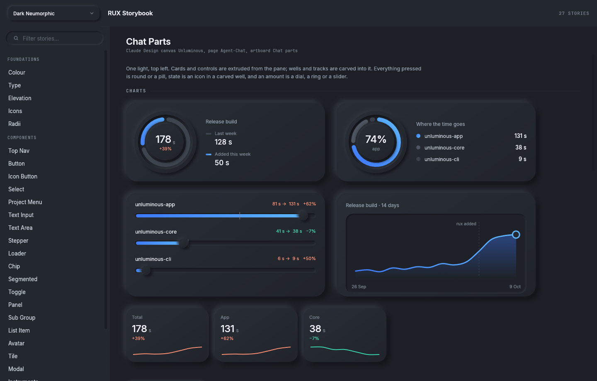
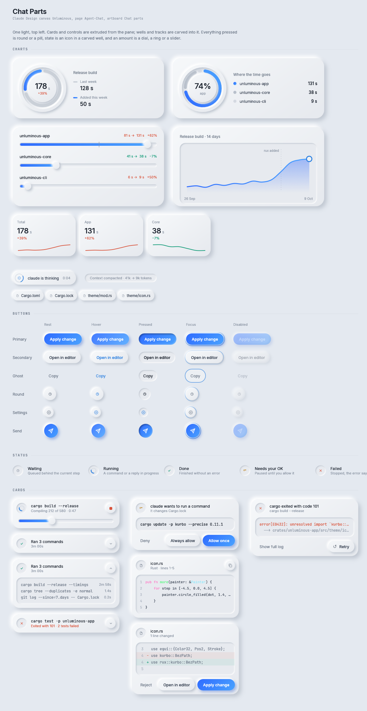
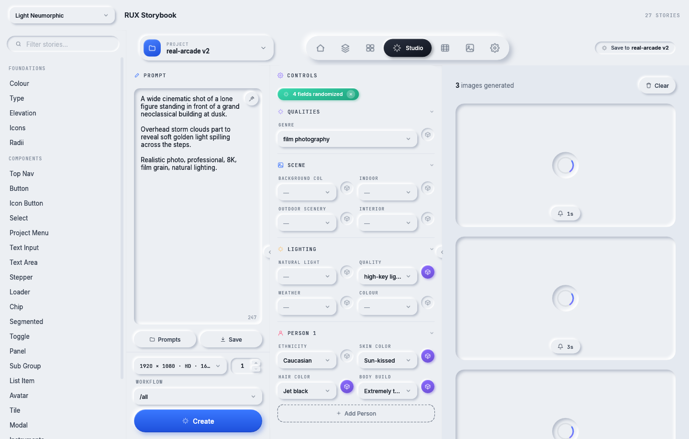
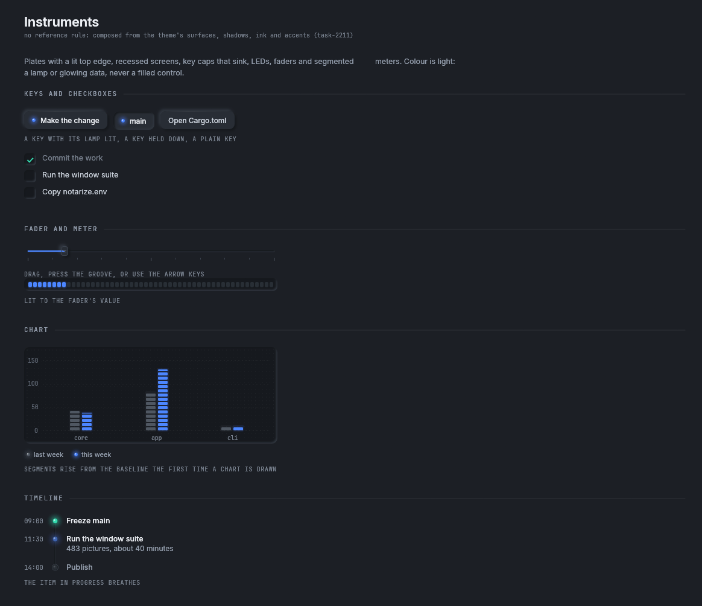
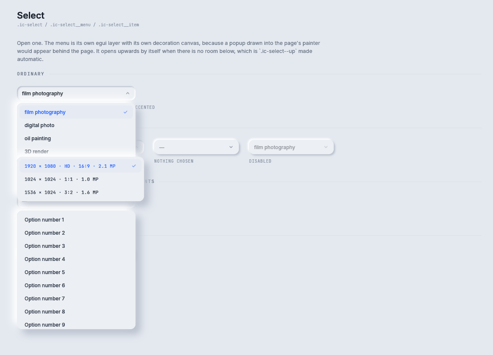
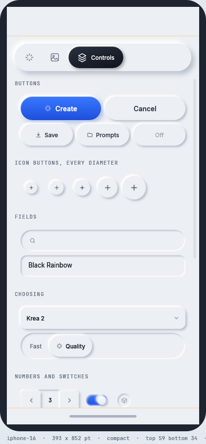
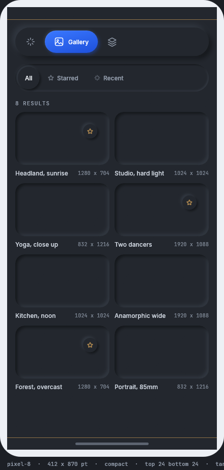

# rux

**Neumorphic components for Rust, drawn on `egui`.**

rux is the Black Rainbow Labs component library. It draws soft, tactile components in which every control
is made of the page's own colour and raised or pressed by shadows, on top of `egui`. The same components
run on Windows, macOS, Linux, iOS and Android. Unluminous, the Black Rainbow Labs code editor, draws its
chat pane, its task board and its Settings window with rux.

[Documentation](docs/README.md) &nbsp;·&nbsp;
[Getting started](docs/getting-started.md) &nbsp;·&nbsp;
[Components](docs/components/README.md) &nbsp;·&nbsp;
[Storybook](#the-storybook)



## Features

- Two themes, `light-neumorphic` and `dark-neumorphic`, each a fixed list of tokens copied from the
  ai-service stylesheets. A component reads the theme and never names a colour.
- Buttons, fields, selects, toggles, navigation, surfaces, chips, loaders and dialogs, copied from the AI
  Studio design and checked against its stylesheet by a test that parses the CSS.
- Instrument controls drawn as hardware: key caps that sink, LEDs, faders, meters, charts, tables and
  timelines.
- The Agent-Chat parts Unluminous's chat pane uses: dials, ring charts, slider tracks, area charts,
  readouts, pill and round buttons, status wells, and cards for commands, code, changes, permission
  requests and errors.
- The Agent-Tasks parts Unluminous's task board uses: a view switch, a sprint ring, lanes, task cards and
  the ticket form's fields.
- Inset shadows, diagonal gradients, glows and rounded clips, which `egui`'s own renderer cannot draw,
  drawn by `vello_cpu`.
- A frame where nothing moved draws no decoration. A hover changes a vertex colour.
- 63 icons, Inter and JetBrains Mono included, and a flexbox and grid layout solver.
- The same components on iOS and Android, with 44 point touch targets, safe areas and bottom sheets.
- A desktop storybook that shows every component in every state in both themes.

## Pictures

<table>
<tr>
<td width="50%"><br><b>Agent-Chat parts</b>, light theme. <a href="docs/components/agent-chat.md">Read more</a></td>
<td width="50%"><br><b>Agent-Tasks parts</b>: lanes, task cards and the ticket fields. <a href="docs/components/agent-tasks.md">Read more</a></td>
</tr>
<tr>
<td><br><b>A whole page</b>: the Image Creator, rebuilt from the components. <a href="docs/examples.md">Read more</a></td>
<td><br><b>Instruments</b>: keys, a fader, a meter, a chart and a timeline. <a href="docs/components/instruments.md">Read more</a></td>
</tr>
<tr>
<td><br><b>Buttons</b> in seven variants and four sizes. <a href="docs/components/buttons.md">Read more</a></td>
<td><br><b>Selects</b>, with their menus open. <a href="docs/components/fields.md">Read more</a></td>
</tr>
</table>

<table>
<tr>
<td></td>
<td></td>
<td></td>
</tr>
</table>

The same components on a phone, in the mobile preview. [Mobile](docs/mobile.md) covers what changes.

## Documentation

The pages are listed in [docs/README.md](docs/README.md). Good places to start:

| Page | What it covers |
|---|---|
| [Product overview](docs/product-overview.md) | what rux is, who it is for, and how it compares with `egui` on its own |
| [Getting started](docs/getting-started.md) | the dependency, the three calls every frame makes, and a whole first window |
| [Components](docs/components/README.md) | every component, with pictures, code and every builder method |
| [Themes](docs/themes.md) | every token, both themes, and a theme made from another application's colours |
| [Layout](docs/layout.md) | measuring and placing components with `Flex`, `Grid` and `Pen` |
| [How rux draws](docs/architecture.md) | `egui` and `vello_cpu` together, and why a still frame costs nothing |
| [Mobile](docs/mobile.md) | touch targets, safe areas, sheets, and the iOS and Android builds |
| [Repository and building](docs/repository.md) | the crates, the commands and the conventions |

## Quick start

```toml
[dependencies]
rux = { git = "https://github.com/Black-Rainbow-Labs/black-rainbow-labs-rux.git", rev = "<commit>" }
egui = "0.36"
eframe = { version = "0.36", default-features = false, features = ["wgpu", "default_fonts", "accesskit"] }
```

```rust
use rux::prelude::*;

// Once, before the first frame.
rux::text::install(ctx);
let state = RuxState::new(Theme::named("dark-neumorphic").unwrap());

// Every frame.
rux::layer(ui, &state, egui::Id::new("page"), area, |rux| {
    rux.ground(area);
    let [field, button] = Flex::row(area).pad(Pad::all(20.0)).gap(12.0).fill(1.0).hug(140.0).solve();
    TextInput::search(&mut query).hint("Search").show(rux, field);
    if Button::new("Create").primary().icon(Icon::Spark).show(rux, button).clicked() {
        // ...
    }
});
state.end_frame();
```

A whole program is in `crates/rux/examples/first_window.rs`:

```sh
cargo run --release -p rux --example first_window
```

Every component has the same two methods. `measure(&self, rux)` answers how big it wants to be, and
`show(self, rux, rect)` draws it into the rectangle it is given and answers what happened. A component
decides nothing about the application, reads the theme instead of naming a colour, and sets the cursor
the stylesheet sets.

## The storybook

```sh
cargo run --release -p rux-storybook
cargo run --release -p rux-storybook -- --theme light-neumorphic --story "Board Parts"
cargo run --release -p rux-storybook -- --list
```

The storybook shows every component in every state, live and interactive, in both themes. The theme
picker is at the top left and a filter over every story and state is under it. Its own theme picker and
filter are rux's `Select` and `TextInput`.

`--background`, `--story`, `--open`, `--size` and `--scroll` reach any state from the command line, so
`pwsh tools/capture-docs.ps1` takes every picture in `docs/images/` without a keystroke or a click.

## On a phone

```sh
cargo run --release -p rux-mobile-preview -- --device iphone-16
pwsh mobile/android/build-android.ps1     # build, install and launch on Android
pwsh mobile/ios/build-ios.ps1             # compile, link, bundle and sign for iOS, on Windows
```

An application says what device it is on once a frame, with `state.set_screen(Screen::phone(size,
insets))`. Every control is then at least 44 points tall, a dialog comes up from the bottom edge, the
nav strip fits the width, and nothing has a hover state. The desktop behaviour does not change.

## How it is checked

```sh
cargo test -p rux      # 109 tests, none of which needs a graphics card
```

`crates/rux/tests/reference.rs` reads the AI Studio stylesheets in `reference/` when it runs, parses them,
and compares every colour in both themes, every radius, every shadow, the padding and gap of every
component and the whole type scale with the declaration it was copied from. A changed token fails a test
that names the declaration. `tests/draw.rs` draws every component in both themes on a desktop and on a
phone in a debug build. [Testing](docs/testing.md) describes the rest.

## Repository

```
crates/rux/        the library, and the only crate a program depends on
examples/          the Image Creator page, rebuilt from the components
storybook/         the desktop storybook
mobile/            the mobile application, its preview, and the iOS and Android shells
reference/         the stylesheets and source the original components were copied from
docs/              the documentation, and its pictures
tasks/             the design documents
tools/             the capture scripts
```

`CLAUDE.md` holds the conventions a change has to follow. `tasks/task-2008-rux-tdd.md` is the design of
the library and `tasks/task-2032-rux-mobile-tdd.md` is the design of the phone support.

## Licence

rux is dual licensed under the [MIT licence](LICENSE-MIT) and the [Apache licence 2.0](LICENSE-APACHE),
at your choice. The included faces, Inter and JetBrains Mono, are under the SIL Open Font License, and
their licences are in `crates/rux/assets/fonts/`.
