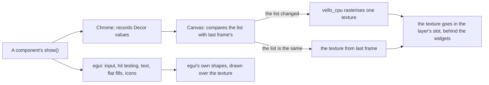

# How rux draws

This page explains how a rux component becomes pixels: which part `egui` draws, which part `vello_cpu`
draws, how the two are put together, and the rule that keeps a still frame free. It has no API
reference. [Getting started](getting-started.md) shows the calls and [Components](components/README.md)
lists every component.

The terms used here are in [the glossary](glossary.md). The full design, with the options that were
weighed and refused, is `tasks/task-2008-rux-tdd.md`.

## Two renderers, one frame



rux is an `egui` component library with a second renderer for its decoration. `egui` does what it is
good at: input routing, hit testing, scroll areas, text layout and shaping, the caret and selection in
a text box, the input method, the clipboard and the accessibility tree.

`epaint`, the part of `egui` that draws, cannot draw four things this design is made of:

| What | Where the design uses it |
|---|---|
| An inset shadow | every well, field, chip and pressed button (`--e-pressed`, `--e-pressed-sm`) |
| A diagonal gradient | the primary button, the dice toggle, the active nav item (`linear-gradient(160deg, ...)`) |
| A glow round a circle | every status dot and LED (`box-shadow: 0 0 6px ...`) |
| A clip with rounded corners | a list scrolled inside a rounded panel |

`vello_cpu` draws all four. rux uses `vello_cpu` 0.1 because `epaint` 0.36 already depends on that
version to draw its font atlas, so rux adds no renderer to the build. The GPU versions of Vello cannot
be used because they pin a different `wgpu` version from `eframe` 0.36, so their textures are a
different type.

`vello_cpu`'s `multithreading` feature stays off. Cargo features are shared across the whole build, so
turning it on changes `epaint`'s settings too, and `epaint`'s glyph rasteriser then panics with
"attempted to rasterize before flushing".

## Chrome, Decor and Canvas

Three types in `crates/rux/src/render/` turn a component's decoration into a texture.

| Type | What it is |
|---|---|
| `Chrome` | What a component calls: `surface(rect, radius, fill, elevation)`, `disc`, `ring`, `arc`, `line`, `glow`, `clip`. A component says what kind of surface it is drawing and never holds a shadow offset. |
| `Decor` | What `Chrome` records: seven kinds of shape and a clip, in points, in the window's coordinates. A plain `Copy` value with no behaviour. |
| `Canvas` | Replays a `Decor` list into `vello_cpu`, rasterises it into premultiplied RGBA8, which is `egui::Color32` byte for byte, and uploads it as one `egui` texture. |

Because a `Decor` list is a plain value, a test can say "a raised surface records the stylesheet's two
shadows, in the stylesheet's order, at the stylesheet's offsets" with no window, no graphics card and no
fonts. `crates/rux/src/render/` has those tests.

## A layer reserves its slot first

```rust
rux::layer(ui, &state, egui::Id::new("page"), area, |rux| {
    rux.ground(area);
    // components
});
```

`rux::layer` does five things in order:

1. adds an empty shape (`egui::Shape::Noop`) to the painter, which reserves a slot behind everything
   drawn after it;
2. makes a recording `Chrome`;
3. runs the closure, which draws components;
4. hands the recorded `Decor` list to the layer's `Canvas`;
5. puts the canvas texture into the reserved slot with `Painter::set`.

So the decoration sits behind every widget in the layer, and the text and icons `egui` draws sit on top
of it.

**The page's ground goes into the chrome.** `Rux::ground` records a `Decor::Rect`. A ground painted
with `egui`'s `rect_filled` would land on top of the texture and hide every shadow in the layer.

## Every popup is its own layer

`egui` draws a dropdown menu, a context menu and a dialog on foreground layers. A painter writes only
to its own layer, so the decoration behind a menu has to be filled into the menu's own painter.
`Rux::overlay` opens an `egui::Area` and calls `rux::layer` inside it. `Select`, `ProjectMenu` and
`Modal` all use it.

A popup that is not open has no layer, no `Chrome` and no canvas. A canvas is dropped the frame after
its layer stops being drawn, which is what `RuxState::end_frame` does.

## The rule: anything that changes every frame stays out of the Decor list

`Canvas::texture_for` compares the whole `Decor` list with the list the current texture was made from.
When the two are equal the frame costs that comparison and nothing else. The list is compared, not
hashed, because a hash collision would show stale pixels and a few hundred `Copy` values compare in
less time than one rasterisation.

Three decisions follow from that rule, and each was measured:

| Decision | Why |
|---|---|
| An icon is a tinted texture | The reference changes an icon's colour on hover in nineteen rules. As decoration, every one of those hovers would rasterise the layer. As a texture, a hover changes a vertex colour. |
| The spinner's arc is a texture, turned by rotating four vertices | As a `Decor::Arc` whose angle moved every frame, a page with three spinners cost 822 ms of processor time a second. As a texture it costs 253 ms a second and the canvas is rasterised once. |
| A flat fill with no shadow is drawn by `egui` | Every hover wash in the reference is one, so moving the pointer down a menu rasterises nothing. `Rux::wash` draws it. |

What does rasterise again is a press (the shadow changes from raised to pressed), a menu opening, a
scroll, a resize and a theme change.

The decoration is rasterised at no more than `MAX_SCALE = 1.5` pixels a point. Its finest detail is
the edge of a rounded rectangle, and the rest is blurs and gradients, which look the same drawn slightly
coarser. Text is unaffected, because `egui` draws text at the display's own resolution.

## An elevation is a CSS box-shadow

The stylesheet says exactly what each shadow is:

```css
--e-raised:  -6px -6px 14px var(--shadow-light), 6px 6px 14px var(--shadow-dark);
--e-pressed: inset 4px 4px 8px var(--shadow-dark), inset -4px -4px 8px var(--shadow-light);
```

rux stores the declaration and draws the declaration. Four conversions turn a CSS shadow into a
`Decor`:

1. **The blur radius is halved** to give the Gaussian's standard deviation, because CSS defines the blur
   radius as twice the standard deviation. `14px` becomes `σ = 7`.
2. **The spread grows the shape before the blur.**
3. **The list is drawn in reverse**, because CSS paints the first shadow in a declaration on top.
4. **An inset shadow is clipped to the shape.** `vello_cpu`'s inverted blur paints everything outside
   the rectangle, so without the clip a well's shadow would cover the whole layer.

One optimisation is checked before it is used. An outer shadow under an opaque surface is cut to the
band around the shape, because the surface covers the middle. A translucent surface shows its own
shadow through itself, so for a translucent fill the shadow is drawn whole. `Chrome::surface` asks the
fill whether it is opaque.

## Text

`egui` lays out, wraps, measures and hit tests the text. `crates/rux/src/text.rs` decides what to hand
it.

- **Weight is a face.** `ab_glyph`, which `egui` uses, cannot read a variable font's weight axis, so
  seven static faces are registered: Inter 400, 500, 600 and 700, and JetBrains Mono 400, 500 and 600. A
  weight rux does not vendor falls back to the heaviest it has.
- **`letter-spacing` and `line-height` are carried through.** CSS gives tracking in `em` and `epaint`
  takes points, so the conversion is `em × size`. The design's small mono labels are `9.5px` at `0.14em`,
  and without the tracking they would be a different design.

## Icons

`crates/rux/src/icon/paths.rs` holds each mark's SVG path data exactly as the source has it. The atlas
rasterises a mark once for each size, stroke and pixel density into an alpha mask, one byte a pixel,
and every use of that mark at that size shares it. Drawing a mark in a colour is a tinted textured
rectangle.

Two tests keep a transcription mistake from shipping: `every_icon_s_path_data_parses` and
`every_mark_stays_inside_its_own_view_box`. The storybook's icon sheet draws every mark at 24 points
and at 13 points, the size it is drawn at inside a control.

## Animation

Controls move: a press sinks over a short time, a light fades on, a chart's bars rise from the
baseline the first time it is drawn. `components/instrument.rs` holds the timings. Everything that
moves is drawn with `egui` or as a turned texture, so an animation does not rasterise the layer on
every frame. `RuxState::set_still(true)` turns motion off, for a person who asked for less motion or for
a test that photographs a frame.

## Measured

Release build, a 1440 by 920 window, from the original design run on 2026-09-20
(`tasks/task-2008-rux-tdd.md`):

| | |
|---|---:|
| Working set, a component story | 188 MB |
| Working set, the example page | 194 MB |
| Idle, nothing animating | 0 to 8 ms of processor time a second |
| The example page, three spinners at 60 frames a second | 253 ms a second, with the canvas rasterised once |
| Decoration texture, full window | 5,175 KB |
| Icon atlas, thirty marks | 36 KB |

Most of the working set is the graphics driver. Unluminous measured a DX12 device and `egui`'s shader
at 135 MB of a 223 MB window, and rux runs on the same stack. `rux-storybook --measure` shows what the
library is holding in the running window.

## Where to go next

- [Themes](themes.md): what a component reads instead of a colour.
- [Layout](layout.md): how a page is divided into the rectangles components draw into.
- [Testing](testing.md): how each of the rules on this page is checked.
