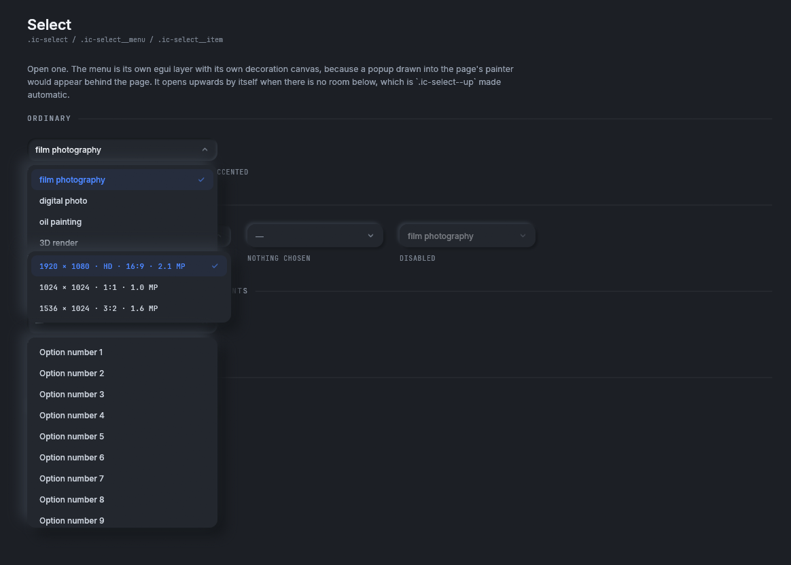
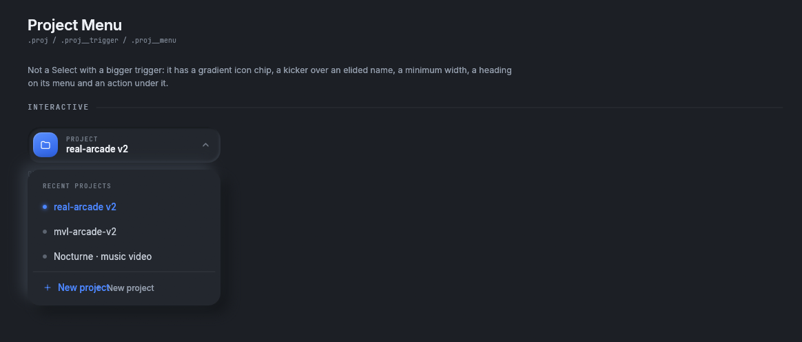
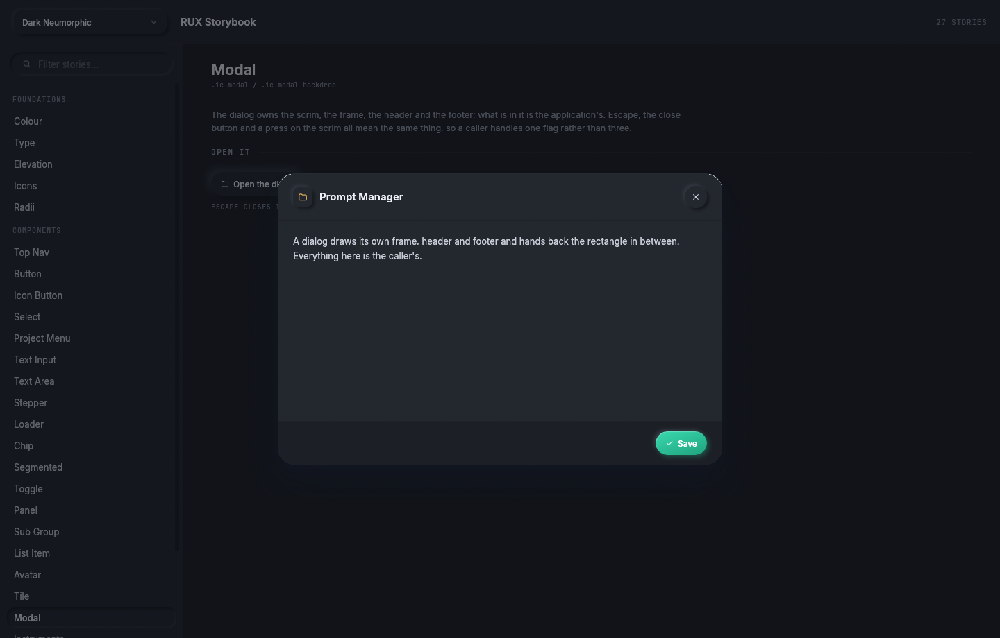
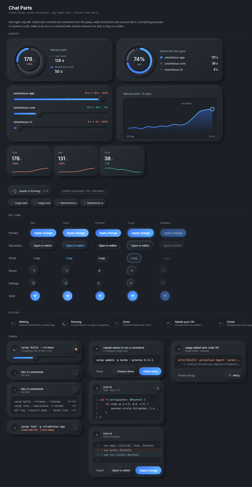
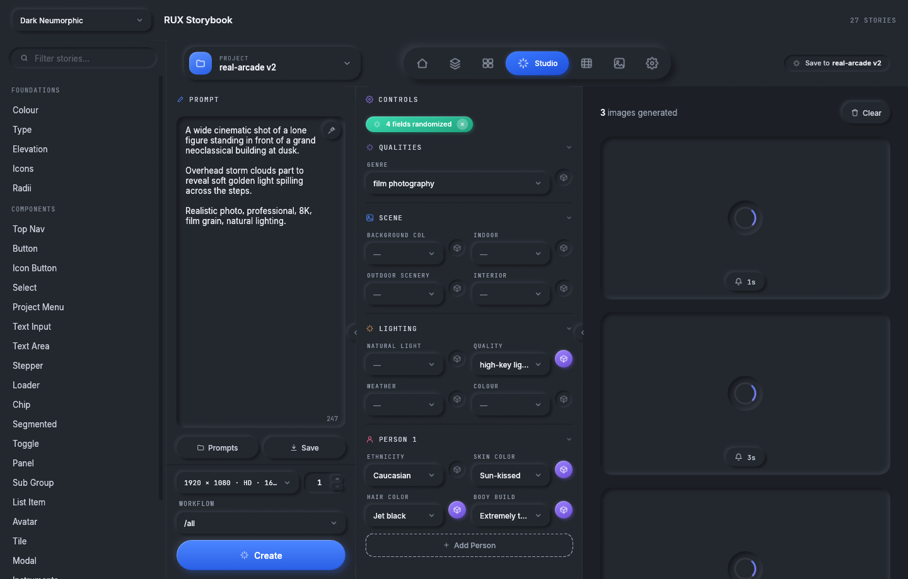

# Components

Every rux component, grouped the way the storybook groups them. Each page shows the component's story in
the dark theme with the light theme under a fold, the code to use it, and every builder method, variant
and outcome field.

Every component has the same shape. `measure(&self, rux)` answers how big it wants to be, and
`show(self, rux, rect)` draws it into the rectangle it is given and answers what happened.
[Getting started](../getting-started.md#the-shape-every-component-has) explains the shape and the three
rules every component keeps.

<table>
<tr>
<td width="33%"> <b><a href="buttons.md">Buttons</a></b> Button, IconButton</td>
<td width="33%"> <b><a href="fields.md">Fields and selects</a></b> TextInput, TextArea, Stepper, Select</td>
<td width="33%"> <b><a href="toggles.md">Toggles</a></b> Segmented, DiceToggle, Switch</td>
</tr>
<tr>
<td> <b><a href="navigation.md">Navigation</a></b> TopNav, ProjectMenu</td>
<td> <b><a href="surfaces.md">Surfaces, rows and chips</a></b> Panel, Well, SubGroup, Divider, ListItem, Chip, Avatar, Tile, Scrollbar</td>
<td> <b><a href="loaders.md">Loaders</a></b> Spinner, Progress, Skeleton</td>
</tr>
<tr>
<td> <b><a href="modal.md">Dialogs</a></b> Modal, as a dialog and as a sheet</td>
<td> <b><a href="instruments.md">Instruments</a></b> Key, Checkbox, Fader, Meter, Chart, Table, Timeline</td>
<td> <b><a href="agent-chat.md">Agent-Chat parts</a></b> Dial, Ring, Track, AreaChart, readouts, pill and round buttons, status wells, cards</td>
</tr>
<tr>
<td> <b><a href="agent-tasks.md">Agent-Tasks parts</a></b> ViewSwitch, SprintRing, Lane, TaskCard, the ticket fields</td>
<td> <b><a href="../icons.md">Icons</a></b> 76 marks</td>
<td> <b><a href="../examples.md">Example pages</a></b> The Image Creator page</td>
</tr>
</table>

## Every component

| Component | Page | Storybook story | Source | Designed from |
|---|---|---|---|---|
| `Button` | [Buttons](buttons.md#button) | Button | `button.rs` | `.ic-create`, `.ic-mini-btn`, `.ic-fbtn`, `.add-scene` |
| `IconButton` | [Buttons](buttons.md#iconbutton) | Icon Button | `icon_button.rs` | `.toolbtn`, `.iconbtn`, `.dock__btn`, `.ic-chev` |
| `TextInput` | [Fields](fields.md#textinput) | Text Input | `field.rs` | `.ic-form-input`, `.search-field` |
| `TextArea` | [Fields](fields.md#textarea) | Text Area | `field.rs` | `.ic-prompt`, `.ic-form-textarea` |
| `Stepper` | [Fields](fields.md#stepper) | Stepper | `stepper.rs` | `.ic-count`, `.num-input` |
| `Select` | [Fields](fields.md#select) | Select | `select.rs` | `.ic-select` |
| `Segmented` | [Toggles](toggles.md#segmented) | Segmented | `toggle.rs` | `.view-toggle`, `.ic-modal-tabs` |
| `DiceToggle`, `Switch` | [Toggles](toggles.md#dicetoggle-and-switch) | Toggle | `toggle.rs` | `.ic-dice`, `.toggle__knob` |
| `TopNav` | [Navigation](navigation.md#topnav) | Top Nav | `top_nav.rs` | `.topnav` |
| `ProjectMenu` | [Navigation](navigation.md#projectmenu) | Project Menu | `project_menu.rs` | `.proj` |
| `Panel`, `Well`, `Divider` | [Surfaces](surfaces.md#panel-and-well) | Panel | `panel.rs` | `.scene`, `.ic-panel`, `.timeline` |
| `SubGroup` | [Surfaces](surfaces.md#subgroup) | Sub Group | `panel.rs` | `.ic-sub` |
| `ListItem` | [Surfaces](surfaces.md#listitem) | List Item | `list.rs` | `.proj__item`, `.ic-modal__list-item` |
| `Chip` | [Surfaces](surfaces.md#chip) | Chip | `chip.rs` | `.meta-chip`, `.ic-elapsed`, `.ic-preset-chip` |
| `Avatar` | [Surfaces](surfaces.md#avatar) | Avatar | `avatar.rs` | `.avatar` |
| `Tile` | [Surfaces](surfaces.md#tile) | Tile | `tile.rs` | `.ic-tile`, `.scene__image` |
| `Scrollbar` | [Surfaces](surfaces.md#scrollbar) | used by every story | `scrollbar.rs` | `.ic-panel__scroll` |
| `Spinner`, `Progress`, `Skeleton` | [Loaders](loaders.md) | Loader | `loader.rs` | `.ic-spinner` |
| `Modal` | [Dialogs](modal.md) | Modal | `modal.rs` | `.ic-modal` |
| `Key`, `Checkbox` | [Instruments](instruments.md#key-and-checkbox) | Instruments | `key.rs` | task-2211 |
| `Fader`, `Meter` | [Instruments](instruments.md#fader-and-meter) | Instruments | `fader.rs` | task-2211 |
| `Chart` | [Instruments](instruments.md#chart) | Instruments | `chart.rs` | task-2211 |
| `Table`, `Timeline` | [Instruments](instruments.md#table-and-timeline) | Instruments | `table.rs` | task-2211 |
| `Dial`, `Ring`, `Track`, `AreaChart` | [Agent-Chat](agent-chat.md#charts) | Chat Parts | `dial.rs` | design canvas, Agent-Chat |
| `Readout`, `Sparkline`, `Legend`, `ThinkingPill`, `NotePill`, `FileChip` | [Agent-Chat](agent-chat.md#readouts-and-pills) | Chat Parts | `answer.rs` | design canvas, Agent-Chat |
| `PillButton`, `RoundButton`, `PillSwitch` | [Agent-Chat](agent-chat.md#buttons) | Chat Parts | `round.rs` | design canvas, Agent-Chat |
| `StatusWell` | [Agent-Chat](agent-chat.md#status) | Chat Parts | `status.rs` | design canvas, Agent-Chat |
| `CommandCard`, `CodeBlock`, `DiffCard`, `PermissionCard`, `ErrorCard` | [Agent-Chat](agent-chat.md#cards) | Chat Parts | `cards.rs` | design canvas, Agent-Chat |
| `ViewSwitch`, `SprintRing`, `Lane`, `TaskCard`, `ChipButton` | [Agent-Tasks](agent-tasks.md) | Board Parts | `board.rs` | design canvas, Agent-Tasks |

Source paths are under `crates/rux/src/components/`. The CSS rules are in `reference/image-creator.css`.

## States every component has

The reference writes three states as CSS pseudo classes: `:hover`, `:active` and `[disabled]`.
`Visual::of(response, enabled, pointer)` answers which of `Idle`, `Hover`, `Active` and `Disabled` a
control is in, and every component reads that instead of asking about the pointer four times. A disabled
control keeps 40% of its colour. On a phone there is no `Hover`, because a finger does not hover.
