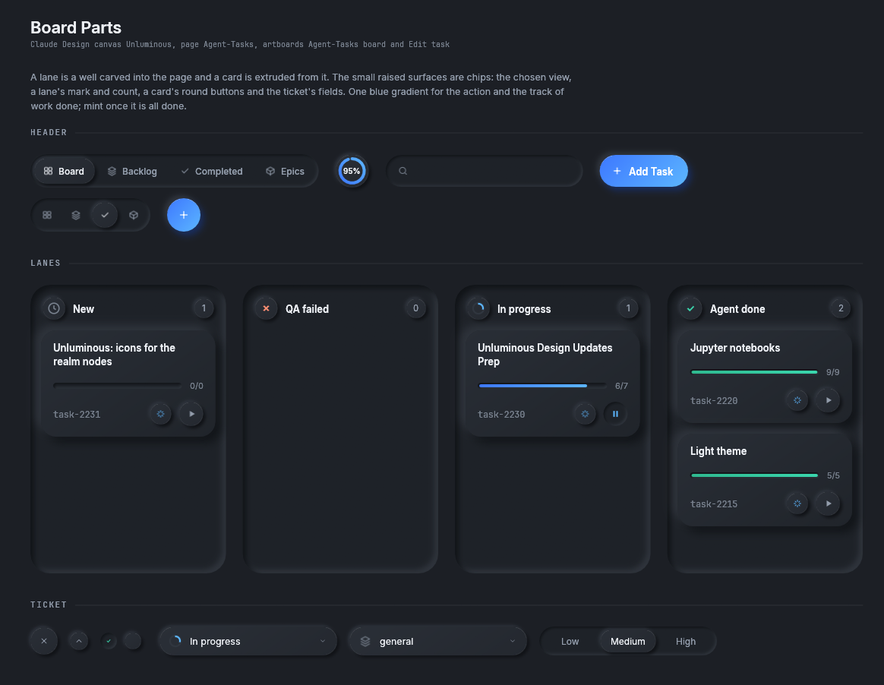
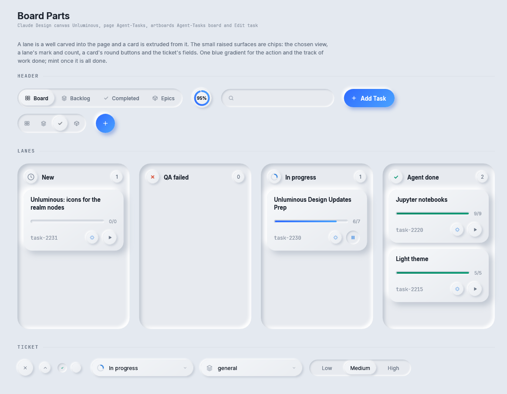

# Agent-Tasks parts

These are the parts Unluminous's task board is drawn with: the view switch, the sprint ring, the search
well, a lane, a task card, and the fields of the ticket form. They were drawn to the Agent-Tasks page of
the Claude Design canvas "Unluminous", artboards "Agent-Tasks board · Dark" and "Edit task", in
task-2241. Unluminous 0.74.0 ships this board.

Storybook: **Components → Board Parts**.



<details><summary>The Board Parts story in the light theme</summary>



</details>

The board is drawn in the Agent-Chat values, `theme.chat`, with one more surface: the **chip**, a flatter
raised surface than a card. A lane's mark, a lane's count, the chosen view and a card's round buttons are
all chips. A lane is a well carved into the page, and a task card is raised out of the lane.

Every part draws and answers what was pressed. Which lane a ticket is in, what a search matches and what
Start does belong to the application.

## The header

```rust
let views = [(Icon::Storyboard, "Board"), (Icon::Layers, "Backlog"), (Icon::Check, "Completed"), (Icon::Cube, "Epics")];
let switch = ViewSwitch::new(&views, self.view);
let width = switch.measure(rux).x;
if let Some(view) = switch.show(rux, Rect::from_min_size(row.left_top(), Vec2::new(width, 44.0))) {
    self.view = view;
}

SprintRing::new(0.95).show(rux, ring);                     // 95% of the sprint's work is done

let field = search_well(rux, well);                        // the well and its magnifier
TextInput::new(&mut self.search).pad(Pad::NONE).show(rux, field);

let add = PillButton::new("Add Task").primary().large().mark(Icon::Plus);
let size = add.measure(rux);
if add.show(rux, Rect::from_min_size(at, size)).clicked() { /* ... */ }
```

| Part | What it is |
|---|---|
| `ViewSwitch::new(&[(Icon, &str)], chosen)` | A carved track with a pill for each view, the chosen one raised. Each pill is as wide as its mark and word. It drops the words and keeps the marks when it is too narrow, and `measure_marks` answers that narrower size. `show` returns `Option<usize>` |
| `SprintRing::new(fraction)` | A 44 point chip with a ring of how much work is done and the share in the middle |
| `search_well(rux, rect) -> Rect` | A 42 point pill well with a magnifier. It answers the rectangle for the caller's own text box |
| `PillButton::new(...).large()` | The 42 point header pill. On a narrow board, `RoundButton::action(Icon::Plus, 16.0, "Add Task")` takes its place |

## Lanes and cards

```rust
let layout = Lane::new("In progress", tickets.len(), LaneMark::Running).show(rux, lane);
let mut top = layout.cards.top();
for ticket in &tickets {
    let card = TaskCard::new(&ticket.title, &ticket.key)
        .todos(ticket.done, ticket.total)
        .assignee(Assignee::Agent(agent_colour))
        .action(if ticket.running { CardAction::Pause } else { CardAction::Start }, "Start Work");
    let height = card.height(rux, layout.cards.width());
    let rect = Rect::from_min_size(egui::pos2(layout.cards.left(), top), Vec2::new(layout.cards.width(), height));
    if card.show(rux, rect).action {
        self.toggle_agent(&ticket.key);
    }
    top += height + Lane::padding(rux);
}
```

A `Lane` is a well with 14 points of padding and a 26 point radius, a heading with a mark, a name and a
count, and room for cards under it. `show` and `Lane::layout(rux, rect)` both answer a `LaneLayout`:
`well`, the well itself, and `cards`, where the cards go. `Lane::heading(rux)` is how far below the top of
the lane the cards start.

| `LaneMark` | Mark | Meaning |
|---|---|---|
| `New` | a clock in the quiet ink | not started |
| `Failed` | a cross in the slower colour | sent back |
| `Running` | a quarter ring in the sky colour over its track | being worked on |
| `Done` | a tick in the faster colour | finished |

A `TaskCard` is raised out of the lane with a 20 point radius. It shows the title, a track of how many
todos are done, the ticket's key, who it is assigned to and one round button.

| `TaskCard` builder | What it does |
|---|---|
| `TaskCard::new(title, key)` | A card with no todos, assigned to a person, with no button |
| `.todos(done, total)` | The todo track and its count. It turns mint when all are done |
| `.assignee(Assignee)` | `Agent(colour)`, a spark in the agent's colour, or `Person`, a figure in the quiet ink |
| `.action(CardAction, label)` | `Start` (a play mark on a chip), `Pause` (a pause mark carved in, in the sky colour, while an agent runs), or `None` |
| `.hovered(bool)` | A wash over the card |
| `.chosen(bool)` | A focus ring round the card |

`TaskCard::height(rux, width)` answers how tall the card is with its title wrapped to `width`.
`TaskCard::height_of(painter, zoom, title, width)` answers the same before a layer is open, for a board
that has to know its scroll height first. `TaskCardOutcome::action` is true when the round button was
pressed.

A task card does not claim the pointer. The application calls `interact` on the card's rectangle before
it shows the card, which makes the whole card pressable for opening the ticket. The round button is added
after it, so a press on the button goes to the button.

## The ticket form

```rust
let statuses = vec!["New".to_string(), "In progress".to_string(), "Agent done".to_string()];
Select::new(&statuses, Some(1)).label("Status").chip(SelectLead::Lane(LaneMark::Running)).show(rux, field, &mut self.status);

let priorities = vec!["Low".to_string(), "Medium".to_string(), "High".to_string()];
if let Some(index) = PillSwitch::new(&priorities, Some(1), "Priority").small().show(rux, field) {
    self.priority = index;
}

if round_check(rux, row, self.todo_done, "Export the window marks as SVG").clicked() {
    self.todo_done = !self.todo_done;
}
ChipButton::new(Icon::X, 36.0, "Close").mark(12.0, Some(1.8)).show(rux, close);
```

| Part | What it is |
|---|---|
| `Select::chip(SelectLead)` | A 38 point pill field on the chip surface with a mark at the left, such as a status or an epic |
| `PillSwitch::small()` | The 38 point choice of priority |
| `round_check(rux, rect, ticked, label)` | A 22 point round tick box for a todo |
| `ChipButton::new(icon, diameter, label)` | A round button on the chip surface: the form's close button at 36, add a todo at 30, a fold disc at 24. `.folds(open)` makes it a disclosure, `.mark(size, stroke)` sets the mark, `.turn(radians)` rotates it |
| `chip_disc(rux, rect)` | A round chip, such as a lane's mark disc or a card's assignee |
| `chip(&chat, rect) -> Fill` | The chip gradient across a rectangle, for a surface of the caller's own |

## The marks

The Editing code page of the same canvas added fifteen marks for Unluminous's rail, its view modes and
its run button, in `Icon::WINDOW`. `Icon::Board` is the board view in the rail. The Settings page added three more, in
`Icon::SETTINGS`. [Icons](../icons.md) shows them all.

## Where to go next

- [Agent-Chat parts](agent-chat.md): the buttons and values the board shares.
- [Fields and selects](fields.md#select): the ordinary `Select` the chip field is built on.
