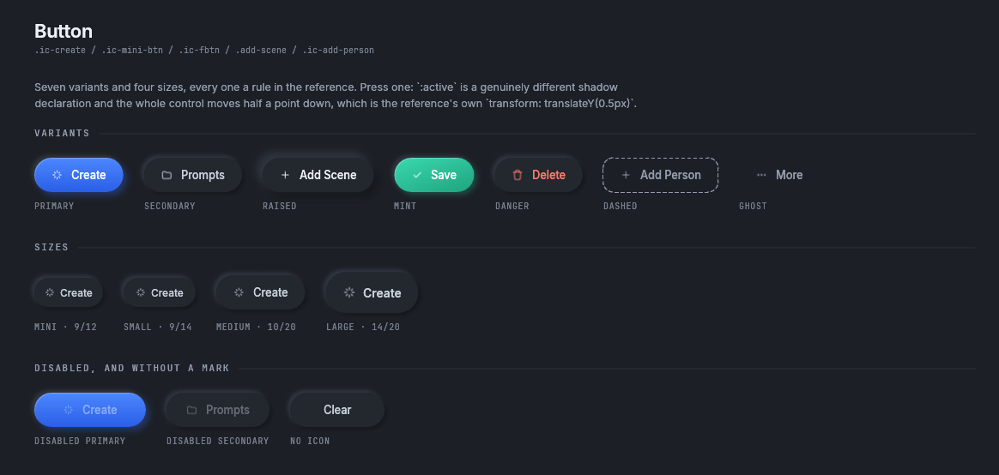
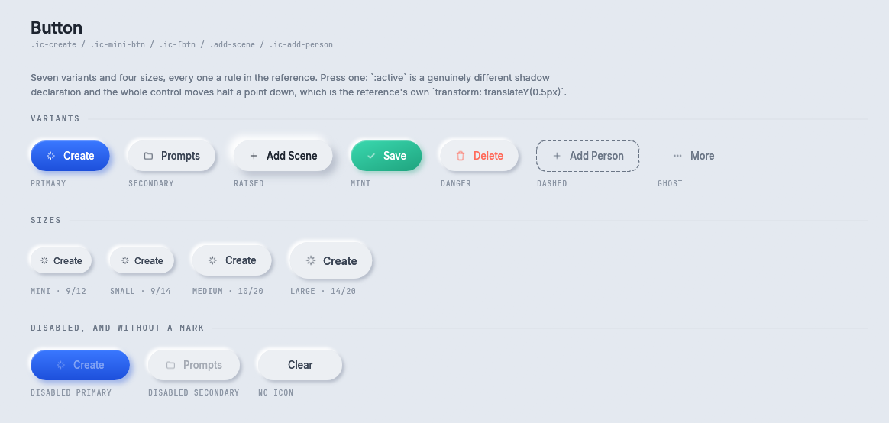
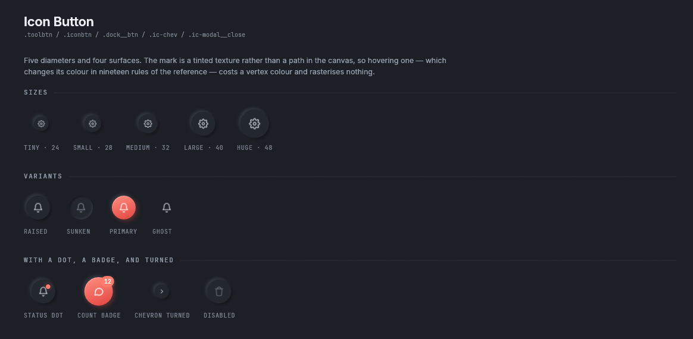
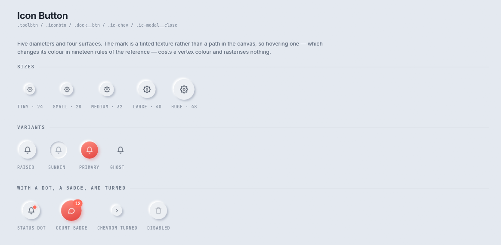

# Buttons

Two components: `Button`, a button with words on it, and `IconButton`, a round button with a mark and
nothing else. The Agent-Chat design has its own pill and round buttons, which are on the
[Agent-Chat parts](agent-chat.md#buttons) page.

Storybook: **Components → Button** and **Components → Icon Button**.

## Button



<details><summary>The Button story in the light theme</summary>



</details>

```rust
if Button::new("Create").primary().icon(Icon::Spark).size(ButtonSize::Large).show(rux, rect).clicked() {
    // start the render
}
```

Press one and it moves half a point down and takes a pressed shadow, which is the reference's own
`:active` rule with `transform: translateY(0.5px)`. Pressing is the one state that rasterises the layer
again.

| Builder | What it does |
|---|---|
| `Button::new(label)` | A secondary button with these words |
| `.variant(ButtonVariant)` | One of the seven variants below |
| `.primary()` | The same as `.variant(ButtonVariant::Primary)` |
| `.size(ButtonSize)` | One of the four sizes below |
| `.icon(Icon)` | A mark before the words |
| `.trailing(Icon)` | A mark after the words, such as a disclosure chevron |
| `.enabled(bool)` | A disabled button keeps 40% of its colour and does not answer clicks |
| `.stretch()` | Fill the width it is given, which is `flex: 1` |

`measure(&self, rux) -> Vec2` and `show(self, rux, rect) -> egui::Response`.

| `ButtonVariant` | CSS rule | When to use it |
|---|---|---|
| `Primary` | `.ic-create`, `.render-btn` | The one action a screen is for. A blue gradient with the deepest shadow |
| `Secondary` (the default) | `.ic-mini-btn`, `.ic-fbtn`, `.ic-clear` | Everything else. A raised surface that takes the accent on hover |
| `Raised` | `.add-scene` | One step further off the page |
| `Mint` | `.ic-fbtn--primary` | Save |
| `Danger` | `.ic-fbtn--danger` | Delete. Coral words on a secondary surface, with no red fill |
| `Dashed` | `.ic-add-person` | Add another of something. A dashed outline with no depth |
| `Ghost` | `.scene__menu-btn`, `.proj__new` | A quiet action with no surface |

| `ButtonSize` | CSS rule | Padding, text, mark |
|---|---|---|
| `Mini` | `.ic-mini-btn` | 9 by 12, 12 point, 12 point mark |
| `Small` (the default) | `.ic-fbtn`, `.ic-clear` | 9 by 14, 12 point |
| `Medium` | `.render-btn`, `.add-scene` | 10 by 20, 13 point, 13 point mark |
| `Large` | `.ic-create` | 14 by 20, 14 point semibold, 15 point mark |

On a phone every size is at least 44 points tall.

## IconButton



<details><summary>The Icon Button story in the light theme</summary>



</details>

```rust
if IconButton::new(Icon::Settings, "Settings").size(IconButtonSize::Large).show(rux, rect).clicked() {
    // open settings
}
```

The second argument to `IconButton::new` is the name a screen reader says. A button with no words still
has a name.

| Builder | What it does |
|---|---|
| `IconButton::new(icon, label)` | A raised 40 point button with this mark, named `label` |
| `.size(IconButtonSize)` | One of the five diameters below |
| `.variant(IconButtonVariant)` | Raised, sunken, primary or ghost |
| `.dot(Color32)` | A status dot at the top right, `.toolbtn__dot` |
| `.badge(u32)` | A count at the top right, `.dock__badge` |
| `.tint(Color32)` | The mark in this colour instead of the variant's ink |
| `.turn(radians)` | Rotate the mark, as a collapsed panel's chevron does |
| `.enabled(bool)` | Disabled or not |

| `IconButtonSize` | Diameter | CSS rule |
|---|---|---|
| `Tiny` | 24 | `.ic-chev` |
| `Small` | 28 | `.ic-prompt-shuffle`, `.ic-dice` |
| `Medium` | 32 | `.ic-modal__close` |
| `Large` (the default) | 40 | `.toolbtn`, `.iconbtn` |
| `Huge` | 48 | `.dock__btn` |

| `IconButtonVariant` | CSS rule |
|---|---|
| `Raised` (the default) | `.toolbtn`, `.iconbtn`, `.ic-chev` |
| `Sunken` | `.ic-dice` when it is off |
| `Primary` | `.dock__btn--primary`: a coral gradient with a glow |
| `Ghost` | `.scene__menu-btn`: no surface until the pointer is on it |

`IconButton::show` draws the circle in the square at the centre of the rectangle it is given, because a
circle drawn into an oblong is an oval. On a phone `measure` answers at least 44 points and the circle
stays its own size. [Mobile](../mobile.md#a-touch-target-grows-the-layout-box) explains why.

## Where to go next

- [Fields and selects](fields.md): what a button usually sits beside.
- [Agent-Chat parts](agent-chat.md#buttons): the pill and round buttons Unluminous uses.
