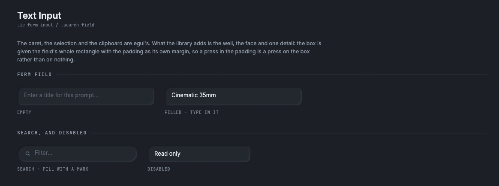
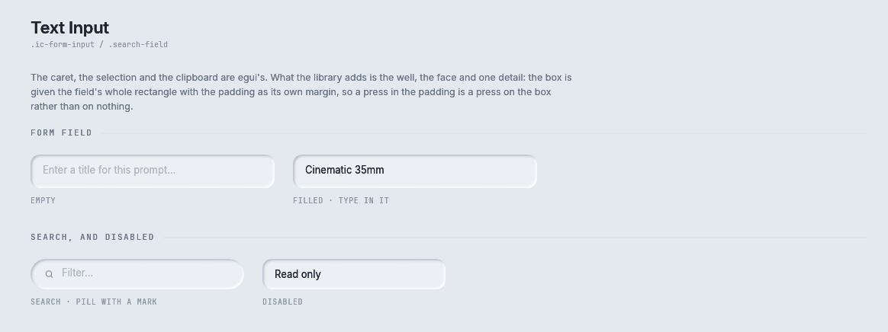
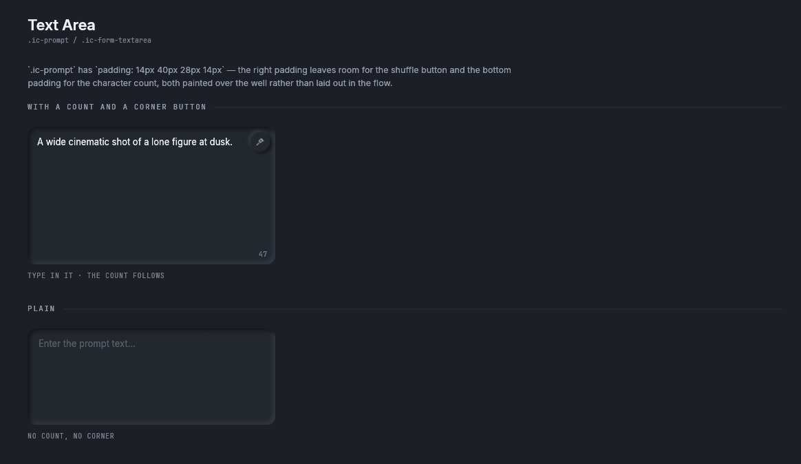
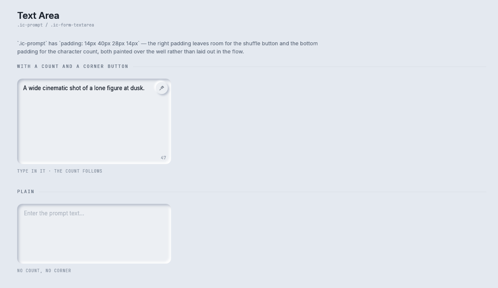
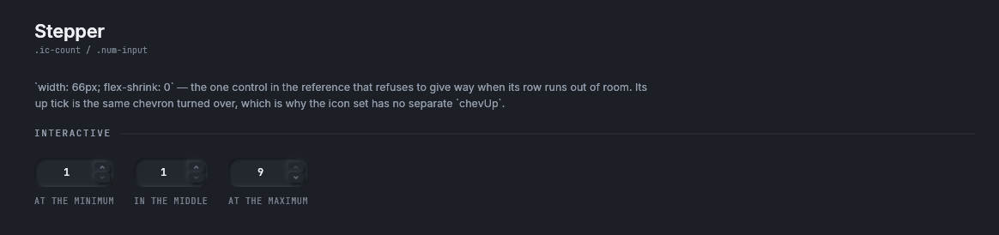
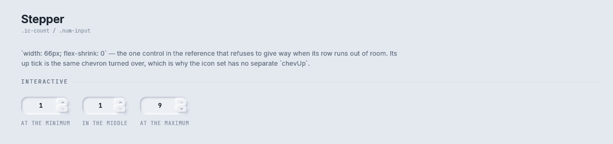
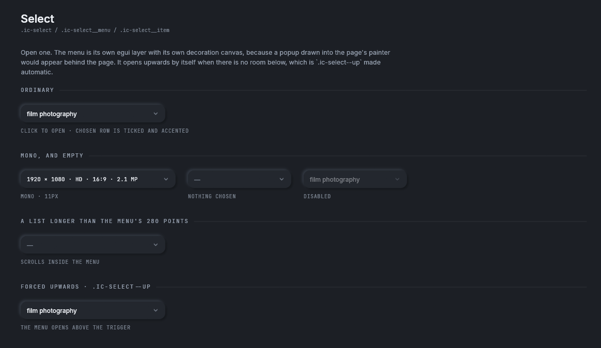
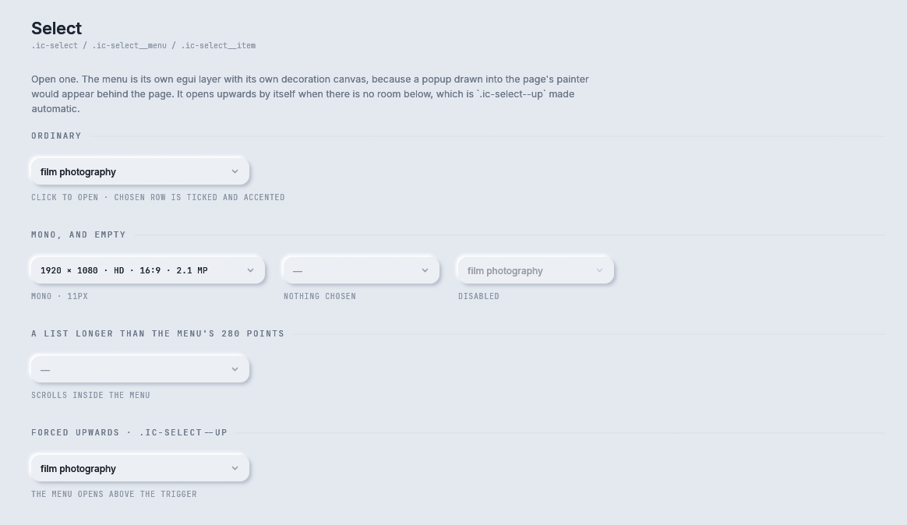

# Fields and selects

Four components for entering a value: `TextInput` for one line, `TextArea` for running text, `Stepper`
for a small whole number, and `Select` for one choice from a list.

Storybook: **Components → Text Input**, **Text Area**, **Stepper** and **Select**.

## TextInput



<details><summary>The Text Input story in the light theme</summary>



</details>

```rust
let outcome = TextInput::search(&mut self.query).hint("Search tasks").show(rux, rect);
if outcome.changed {
    self.filter_results();
}
if outcome.submitted {
    self.open_first_result();
}
```

The caret, the selection, the clipboard and the input method are `egui`'s. rux draws the well the text
box sits in and chooses the face.

The text box is given the field's whole rectangle, with the padding as its margin. A text box laid out
as a one line strip inside a taller control leaves its padding unclaimed, so a press there would reach
nothing and a keystroke would go to whatever is behind. With the margin inside the box, every point of
the field is the text box.

| Builder | What it does |
|---|---|
| `TextInput::new(&mut String)` | `.ic-form-input`: padding 12 by 16, `--r-md`, 13 point text |
| `TextInput::search(&mut String)` | `.search-field`: a pill with a magnifier |
| `.hint(&str)` | Placeholder text, set in the field's own font |
| `.icon(Icon)` | A mark at the left |
| `.style(Style)` | The face and size of the text |
| `.pad(Pad)` | The padding inside the well |
| `.enabled(bool)` | Disabled or not |
| `.label(&str)` | The name a screen reader says |
| `.id_salt(hash)` | Keep the same `egui` id when the field moves, so it keeps the keyboard |

`show` returns a `TextInputOutcome`:

| Field | Meaning |
|---|---|
| `changed` | The text changed this frame |
| `focused` | The field has the keyboard |
| `submitted` | Enter was pressed while the field had the keyboard |

A field's `egui` id comes from where it is drawn, so a field that moves would lose the keyboard. On a
phone the soft keyboard moves the page up, so a field on a phone sets `.id_salt(...)`.

## TextArea



<details><summary>The Text Area story in the light theme</summary>



</details>

```rust
let outcome = TextArea::new(&mut self.prompt)
    .hint("Describe the image")
    .count(true)
    .corner(Icon::Wand)
    .show(rux, rect);
if outcome.corner_pressed {
    self.prompt = shuffle(&self.prompt);
}
```

`.ic-prompt-wrap` and `.ic-prompt`: a pressed well with padding 14, 40, 28 and 14 points, which leaves
room for the corner button and the character count drawn over it.

| Builder | What it does |
|---|---|
| `TextArea::new(&mut String)` | A text area at least 280 points tall |
| `.hint(&str)` | Placeholder text |
| `.count(bool)` | Show the character count at the bottom right |
| `.corner(Icon)` | A small round button at the top right |
| `.enabled(bool)`, `.label(&str)`, `.id_salt(hash)` | As for `TextInput` |

`TextAreaOutcome` has `changed`, `focused` and `corner_pressed`.

## Stepper



<details><summary>The Stepper story in the light theme</summary>



</details>

```rust
if let Some(count) = Stepper::new(self.count, 1, 9).show(rux, rect).changed {
    self.count = count;
}
```

`.ic-count` and `.num-input`: a number with an up tick and a down tick. The value never goes past
`min` or `max`.

Stepper is `STEPPER_WIDTH`, 66 points, wide, and the reference says `flex-shrink: 0`. Lay it out with
`.fixed(STEPPER_WIDTH)` so a narrow row cannot squeeze it. On a phone the two halves are each at least
44 points.

| Builder | What it does |
|---|---|
| `Stepper::new(value, min, max)` | The number and its range, as `i64` |
| `.enabled(bool)` | Disabled or not |
| `.label(&'static str)` | The name a screen reader says |

`StepperOutcome::changed` is `Some(new_value)` in the frame a tick was pressed.

## Select



<details><summary>The Select story in the light theme</summary>



</details>


<details><summary>The menus open, light theme</summary>


</details>

```rust
// kept by the application, one for each select on the screen
struct Page { genre: SelectState, genre_index: Option<usize>, genres: Vec<String> }

let outcome = Select::new(&page.genres, page.genre_index)
    .placeholder("Any genre")
    .show(rux, rect, &mut page.genre);
if let Some(index) = outcome.chosen {
    page.genre_index = Some(index);
}
```

`.ic-select`: a trigger that says what is chosen, and a menu that opens under it. The menu opens upwards
when there is no room below, which is `.ic-select--up`, and it scrolls past
`SELECT_MENU_MAX_HEIGHT`, 280 points.

`Select` keeps no state of its own. Whether the menu is open and how far it is scrolled are in a
`SelectState` that the application owns and passes in by `&mut`. That is what lets two selects on one
screen open separately.

The menu is its own `egui` layer, opened with `Rux::overlay`, so it draws over everything and its
shadows are drawn into its own layer. Pressing anywhere outside the menu closes it.

| Builder | What it does |
|---|---|
| `Select::new(&[String], Option<usize>)` | The options, and which one is chosen |
| `.placeholder(&str)` | What the trigger says when nothing is chosen. The default is `—` |
| `.mono(bool)` | The mono face, `.ic-select--mono`, for sizes and paths |
| `.up(bool)` | Always open upwards |
| `.enabled(bool)` | Disabled or not |
| `.label(&str)` | The name a screen reader says. Each menu row is named by its own words |
| `.chip(SelectLead)` | The Agent-Tasks field: a 38 point pill on the chip surface with a mark at the left |
| `.zoom(f32)` | Draw at this many times the stylesheet's size |
| `.menu_elevation(Elevation)` | The menu's shadow. The default is the theme's modal elevation |

`show(self, rux, rect, &mut SelectState) -> SelectOutcome`. `SelectOutcome` has `chosen`, which is
`Some(index)` in the frame a row was pressed, and `toggled`, which is true in the frame the menu opened
or closed.

`SelectLead` is `Mark(Icon, Color32)`, `Lane(LaneMark)` for a ticket's status, or `None`.

On a phone the trigger and the rows are at least 44 points tall, and on a compact screen the menu is a
sheet from the bottom edge.

## Where to go next

- [Toggles](toggles.md): segmented controls, the dice toggle and the switch.
- [Navigation](navigation.md): `ProjectMenu`, which is a picker with more parts than a `Select`.
