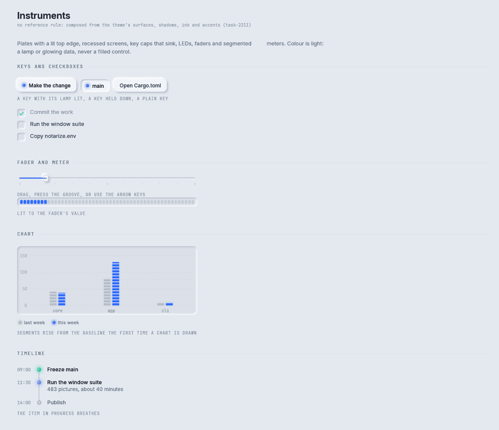

# Instruments

The instrument controls draw an answer as hardware: machined modules on a studio desk, after Teenage
Engineering and Braun. Unluminous asked for them for the answers in its chat pane (task-2211). They are
key caps, a checkbox, a fader, a meter, a chart, a table and a timeline, all built from the five pieces
in `components/instrument.rs`.

Storybook: **Components → Instruments**.


<details><summary>The Instruments story in the light theme</summary>



</details>

## The five pieces

| Piece | What it is | Function |
|---|---|---|
| Plate | A raised panel with a lit line along its top edge, where machined metal catches the light | `instrument::plate(rux, rect, radius, padding) -> Rect` |
| Screen | A recessed area darker than anything else, with a faint dot grid. Data is shown here | `instrument::screen(rux, rect, radius, graticule)` |
| LED | A small lit dot with a soft glow. Colour appears here | `instrument::led(painter, centre, radius, colour, off, brightness)` and `led_for(rux, id, centre, radius, colour, on)` |
| Encoder colours | The colours for data series: the theme's accents in the order an OP-1 colours its four encoders | `Instrument::of(theme).series(index)` |
| Motion | A press sinks, a light fades on, a value rises from its baseline | `instrument::timing` and the functions below |

**A control is never filled with an accent colour. It lights one.** A key that matters more than its
neighbours has its LED lit. A chosen key stays down.

**None of it is a new token.** `Instrument::of(theme)` works every colour out from the theme's
surfaces, shadows, ink and accents: `screen`, `dots`, `edge`, `plate`, `led_off`, `rule`, the five
`series` colours (blue, mint, amber, coral, violet), and `quiet` for a comparison. A theme that changes
those changes the instruments, and `tests/reference.rs` has nothing new to check.

### Motion

| `instrument::timing` | Seconds | What moves |
|---|---:|---|
| `PRESS` | 0.09 | a key sinking or coming back up |
| `LIGHT` | 0.16 | an LED fading on or off |
| `RISE` | 0.42 | a bar, a segment run or a trace rising from the baseline |
| `STAGGER` | 0.03 | between one bar starting to rise and the next |
| `ROLL` | 0.6 | a number rolling to its value |
| `BREATH` | 2.4 | one breath of an LED that is working |
| `BREATHING_FOR` | 12.0 | how long an LED breathes before it holds still, so a finished answer does not keep the window drawing |

`toward(rux, id, on, seconds)` answers a value moving between 0 and 1, `appearing(rux, id, delay,
seconds)` answers how far through its first appearance something is, and `age(rux, id)` answers how long
ago an id first appeared. `ease_out` and `ease_back` shape the curve, and `sinking(raised, pressed, t)`
blends a raised elevation into a pressed one.

Everything that moves is drawn with `egui` or as a turned texture, so an instrument that is animating
does not rasterise its layer on every frame. `RuxState::set_still(true)` stops the motion.

## Key and Checkbox

```rust
let blue = rux.theme().accent.blue;
let make = Key::new("Make the change").led(blue, true);         // a key with its lamp lit
let size = make.measure(rux);
if make.show(rux, Rect::from_min_size(at, size)).clicked() { /* ... */ }

let branch = Key::new("main").down(true).led(blue, true);       // a key held down

if Checkbox::new(self.done, "Run the window suite").show(rux, row).clicked() {
    self.done = !self.done;
}
```

A `Key` is a raised cap with a lit top edge. Pressing it sinks it a point and turns its shadow inward over
`timing::PRESS`.

| `Key` builder | What it does |
|---|---|
| `Key::new(label)` | A key 30 points tall |
| `.led(Color32, lit)` | An LED left of the words |
| `.down(bool)` | Held down |
| `.chosen(Color32, on)` | A chosen key in a row of choices: down, with its words in the colour |
| `.tinted(Color32)` | The words in this colour |
| `.compact()` | 24 points tall |
| `.enabled(bool)`, `.id(Id)` | Disabled or not, and the id its motion is remembered under |

A `Checkbox` is a well that stays down when ticked, with a mint tick. The whole row is the target.
`.settles(true)`, the default, makes a ticked item's words quieter, which suits a checklist. Pass
`false` for a form setting. `.colour(Color32)` sets the tick's colour. `height_at(rux, width)` answers
how tall the row is when its words wrap.

## Fader and Meter

```rust
let fader = Fader::new(egui::Id::new("budget"), self.budget, 0.0, 2000.0).step(50.0).label("Token budget");
if let Some(value) = fader.show(rux, rect).changed {
    self.budget = value;
}
Meter::new((self.budget / 2000.0) as f32).top(rux.theme().accent.amber).show(rux, meter);
```

A fader is a value somebody sets: a groove sunk into the plate, tick marks under it, the part of the
groove the value has covered lit in its colour, and a raised cap with an engraved line across it. It is
dragged, pressed anywhere along the groove, or moved with the arrow keys.

| `Fader` | What it does |
|---|---|
| `Fader::new(id, value, min, max)` | A fader over this range, as `f64` |
| `.step(f64)` | Snap to multiples of this |
| `.colour(Color32)` | The colour of the lit run |
| `.label(impl Into<String>)` | The name a screen reader says |
| `Fader::height(rux)` | How tall a fader is |

`FaderOutcome` has `changed`, which is `Some(value)` when it moved, and `dragging`.

A meter is a value somebody reads: a row of segments on a screen, lit up to a fraction, the way a level
meter on a mixing desk is. `Meter::new(fraction)`, `.colour(Color32)`, `.top(Color32)` for the last
tenth, and `Meter::height(rux)`.

## Chart

```rust
let labels: Vec<String> = ["core", "app", "cli"].iter().map(|label| label.to_string()).collect();
let format = |value: f64| format!("{value:.0} s");
let chart = Chart::new(egui::Id::new("build-times"), ChartKind::Bar, &labels, &format)
    .series(Series { name: "last week", values: &[41.0, 81.0, 9.0], colour: Instrument::of(rux.theme()).quiet })
    .series(Series { name: "this week", values: &[38.0, 131.0, 9.0], colour: rux.theme().accent.blue });
let height = chart.height_at(rux, 420.0);
let outcome = chart.show(rux, Rect::from_min_size(at, Vec2::new(420.0, height)));
```

The plot is a recessed screen with a graticule. Gridlines fall on round numbers, and the numbers on the
axes are in the mono face. Bars are columns of lit segments, the way a level meter is. A line is a trace
with a soft glow along it. The value under the pointer is read out in the screen's top right corner,
which is where an instrument shows a reading.

`ChartKind` is `Bar`, `Line`, `Area` or `Donut`. `.stacked(true)` stacks the series. `height_at(rux,
width)` includes the legend. `ChartOutcome::hovered` is `Some((series, index))` for the value under the
pointer. `nice_ticks(low, high, count)` answers gridline values that are 1, 2, 2.5 or 5 times a power of
ten.

The bars rise, the trace draws itself and the reading changes on the `egui` painter, so none of that
rasterises the layer again.

## Table and Timeline

```rust
let columns = [Column { label: "Crate", align: Align::Left }, Column { label: "Tests", align: Align::Right }];
let rows = vec![vec!["rux".to_string(), "109".to_string()], vec!["rux-storybook".to_string(), "6".to_string()]];
let table = Table::new(egui::Id::new("tests"), &columns, &rows).sorted(Some((1, true)));
let height = table.height_at(rux, 320.0);
if let Some(column) = table.show(rux, Rect::from_min_size(at, Vec2::new(320.0, height))).sort {
    self.sort_by(column);
}
```

A table is rows of records on a recessed screen: silkscreen headers, hairline rows, numbers in tabular
figures and aligned right, and a cell cut short instead of wrapped. Pressing a header reports its column
in `TableOutcome::sort`. The order of the rows is the caller's. `is_figure(cell)` is how a cell is judged
to be a number, which decides its face.

```rust
let items = [
    Item { time: "09:00", title: "Freeze main", text: "", stage: Stage::Done },
    Item { time: "11:30", title: "Run the window suite", text: "483 pictures", stage: Stage::Active },
    Item { time: "14:00", title: "Publish", text: "", stage: Stage::Todo },
];
let line = Timeline::new(egui::Id::new("release"), &items);
let height = line.height_at(rux, 420.0);
line.show(rux, Rect::from_min_size(at, Vec2::new(420.0, height)));
```

A timeline is a groove with an LED for each item: lit for done, breathing for the one in progress, and
dark for what is to come.

## Where to go next

- [Agent-Chat parts](agent-chat.md): the design that followed the instruments, in which an amount is an
  arc or a slider instead of segments.
- [Themes](../themes.md): the values `Instrument::of` works its colours out from.
