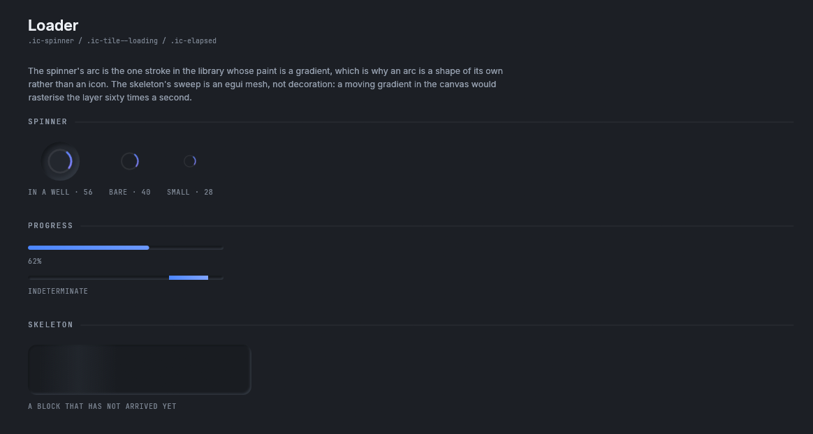
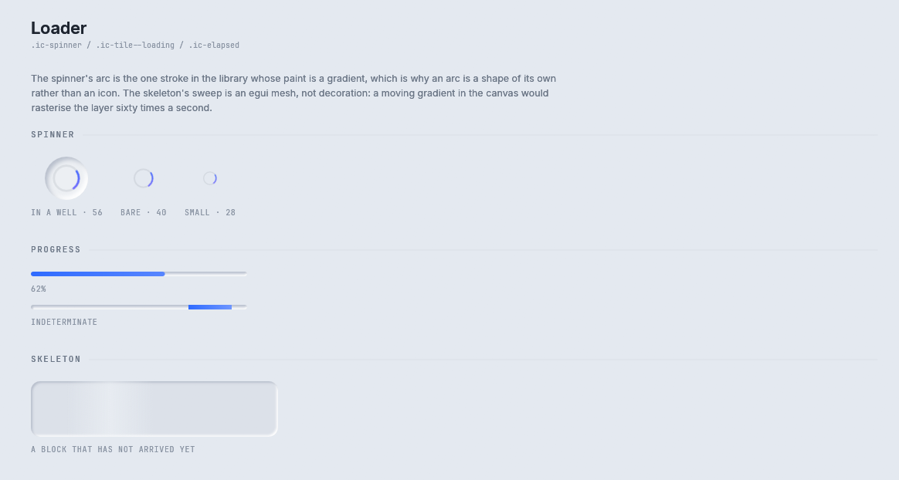

# Loaders

Three components for waiting: `Spinner`, `Progress` and `Skeleton`.

Storybook: **Components → Loader**.



<details><summary>The Loader story in the light theme</summary>



</details>

```rust
Spinner::new().show(rux, rect);                                   // 56 points, on a pressed disc
Spinner::new().diameter(40.0).bare().show(rux, rect);             // no disc
Progress::new(0.62).show(rux, bar);                               // a fraction from 0 to 1
Progress::indeterminate().show(rux, bar);                         // sweeps
Skeleton::new().radius(12.0).show(rux, block);                    // a placeholder block

let words = elapsed_text(seconds);                                // "4s", "2m 5s", for an elapsed chip
```

None of the three answers a response. They draw and return `()`.

## Spinner

`.ic-spinner`, `.ic-spinner__ring` and `@keyframes ic-spin`. The arc runs from blue into violet, which is
the one place in the library where a stroke takes a gradient.

The arc turns every frame, so it must not be decoration. It is drawn once into a texture and turned by
rotating the four corners of the textured rectangle. As a `Decor::Arc` whose angle changed every frame,
a page with three spinners on it cost 822 ms of processor time a second. As a texture the same page costs
253 ms a second and its canvas is rasterised once.

| Builder | What it does |
|---|---|
| `Spinner::new()` | `SPINNER_DIAMETER`, 56 points, on a pressed disc |
| `.diameter(f32)` | Another size |
| `.bare()` | Leave out the disc behind the arc |

## Progress

A pressed track with the theme's `progress` gradient along it. `Progress::new(fraction)` fills to a
fraction from 0 to 1. `Progress::indeterminate()` sweeps a short run along the track, for work whose
length is unknown. `.height(f32)` sets the track's height.

## Skeleton

A sunken block with a highlight sweeping across it, standing in for content that has not loaded. The
sweep is an `egui` mesh, so it does not rasterise the layer. `.radius(f32)` sets the corners.

## Stopping the motion

`RuxState::set_still(true)` stops every animation, including these. Use it for a person who has asked
for less motion, and in a test that photographs a frame.

## Where to go next

- [Agent-Chat parts](agent-chat.md#status): `StatusWell`, whose running state is a turning arc drawn the
  same way.
- [Surfaces](surfaces.md#tile): the tile a spinner usually sits in.
