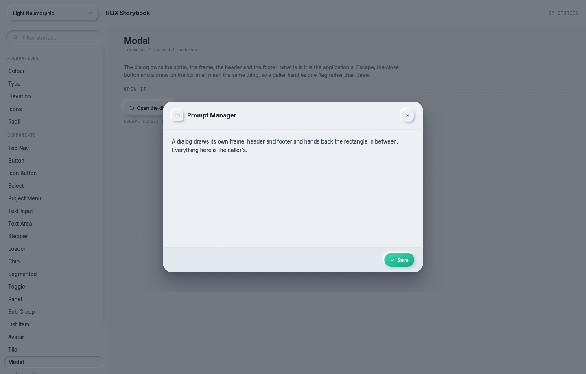

# Dialogs

`Modal` is a dialog over a dimmed page. On a phone it is a sheet that comes up from the bottom edge.

Storybook: **Components → Modal**. The story has a button that opens the dialog, and `--open` opens it
from the command line.


<details><summary>The dialog in the light theme</summary>



</details>

```rust
if self.prompts_open {
    let (outcome, _) = Modal::new("Prompt Manager")
        .icon(Icon::Folder)
        .icon_tint(rux.theme().accent.amber)
        .size(Vec2::new(640.0, 420.0))
        .footer(true)
        .show(rux, |rux, layout| {
            let (list, editor) = split_body(rux, layout.body, 260.0);
            // draw the list into `list`, the editor into `editor`, and the buttons into `layout.foot`
        });
    if outcome.dismissed {
        self.prompts_open = false;
    }
}
```

`.ic-modal-backdrop` and `.ic-modal`. `Modal` draws the scrim, the frame, the header with its title and
close button, and the footer. It hands back the rectangles for the body and the footer, and the caller
fills them. What is in a dialog belongs to the application. What a dialog is belongs to the library.

The closure passed to `show` gets a `Rux` on the dialog's own layer, so components drawn inside it are
drawn over the page and their shadows are drawn into the dialog's layer. The application decides whether
the dialog is open. `Modal` has no state of its own.

| Builder | What it does |
|---|---|
| `Modal::new(title)` | A dialog with this title |
| `.icon(Icon)`, `.icon_tint(Color32)` | A 28 point raised chip with a mark beside the title, `.ic-modal__title-icon` |
| `.size(Vec2)` | The size wanted. It is limited to the window less 48 points across and 64 points down |
| `.footer(bool)` | Leave room for a footer row |
| `.raised()` | Use `--e-raised-lg` for the frame instead of `--e-modal` |
| `.light_dismiss(bool)` | Whether pressing the scrim closes it. On by default |
| `.present(Present)` | `Dialog`, `Sheet`, or `Automatic` (the default) |

`show<R>(self, rux, add: impl FnOnce(&mut Rux, ModalOutcome) -> R) -> (ModalOutcome, R)`.

| `ModalOutcome` field | Meaning |
|---|---|
| `dismissed` | The close button, the scrim or Escape was pressed. All three mean the same, so the caller handles one flag |
| `body` | The rectangle between the header and the footer |
| `foot` | The footer's rectangle, or an empty rectangle when there is no footer |

`split_body(rux, body, left_width)` divides the body into a list on the left and an editor on the
right with a hairline between them, which is `.ic-modal__body { grid-template-columns: 260px 1fr }`.

## Dialog and sheet

| `Present` | What it draws |
|---|---|
| `Dialog` | Centred, `min(920, width − 48)` by `min(640, height − 64)` |
| `Sheet` | From the bottom edge, full width less 12 points, only the top corners rounded, with a grabber, and the device's bottom inset added to the footer |
| `Automatic` | A dialog with a mouse and a sheet on a compact screen |

`sheet_frame(screen, wanted_height, footer)` answers the rectangle a sheet takes. Its height is limited
so some of the page still shows above it. `Select` uses the same frame for its menu on a phone, so the
two look like one idea.

## What it does not draw

The reference puts `backdrop-filter: blur(8px)` on the scrim. Blurring what is behind a layer means
reading the frame back and filtering it, which is a render pass and a texture the size of the window on
every frame the dialog is open. The scrim's opacity does the work, and the blur is left out.

## Where to go next

- [Mobile](../mobile.md): what else changes on a phone.
- [Example pages](../examples.md): the Prompt Manager dialog in the Image Creator page.
