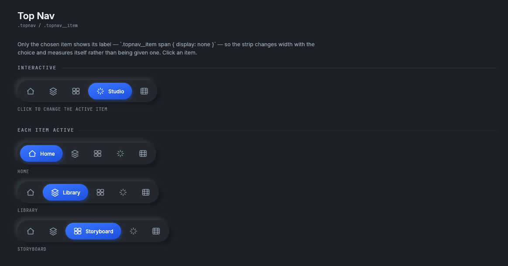
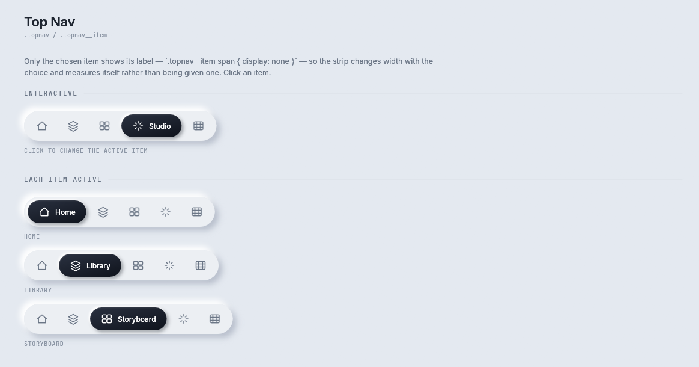
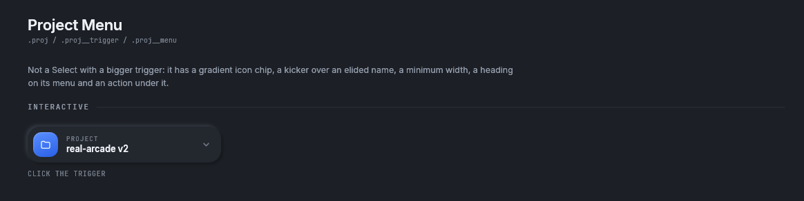
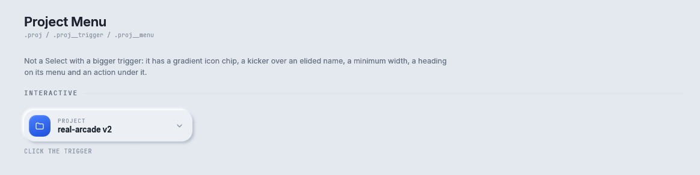
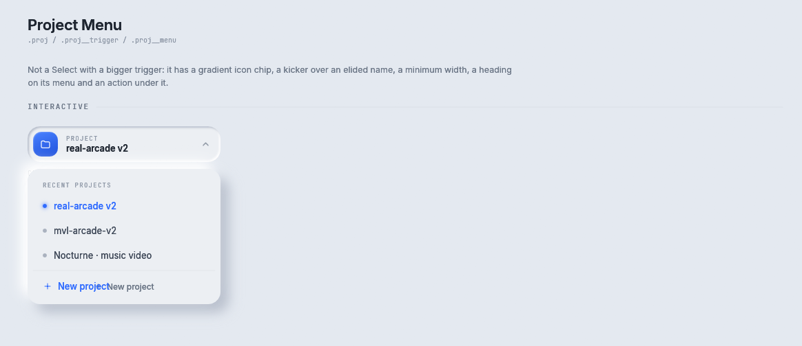

# Navigation

Two components that move a person around an application: `TopNav`, the strip of items along the top of
a page, and `ProjectMenu`, the project picker at the top left.

Storybook: **Components → Top Nav** and **Components → Project Menu**.

## TopNav



<details><summary>The Top Nav story in the light theme</summary>



</details>

```rust
const NAV: &[NavItem] = &[
    NavItem::new("home", Icon::Home, "Home"),
    NavItem::new("studio", Icon::Spark, "Studio"),
    NavItem::new("gallery", Icon::Image, "Gallery"),
];

let nav = TopNav::new(NAV, self.page);
let size = nav.measure(rux);
let rect = Rect::from_center_size(bar.center(), size);
if let Some(index) = nav.show(rux, rect).chosen {
    self.page = index;
}
```

`.topnav` and `.topnav__item`. One rule decides the whole component:
`.topnav__item span { display: none }` with `.topnav__item.is-active span { display: inline }`. **Only the chosen item shows its
label.** So the chosen item is easy to see, and the strip's width changes with which item is chosen.
That is why `TopNav` measures itself instead of being given a width.

| Method | What it does |
|---|---|
| `TopNav::new(&[NavItem], active)` | The items and which is chosen |
| `measure(&self, rux)` | The size with the chosen item's label showing |
| `measure_min(&self, rux)` | The smallest size it can be drawn at |
| `fit_for(&self, rux, room) -> Fit` | The widest form that fits in `room` points |
| `show(self, rux, rect) -> TopNavOutcome` | Draws the strip. `chosen` is `Some(index)` when an item was pressed |

`NavItem::new(id, icon, label)` is a `const fn`, so a nav can be a constant. The `id` is for the
application. rux does not read it.

`Fit` is how `TopNav` fits a narrow screen. `Full` shows the chosen item's label. `IconsOnly` drops it,
which is the reference's own state for an item that is not chosen. `Trimmed` also trims each item's side
padding to 10 points. On a phone `TopNav` chooses the widest `Fit` that fits the rectangle it is given.

## ProjectMenu




<details><summary>The Project Menu story in the light theme</summary>





</details>

```rust
let outcome = ProjectMenu::new(&self.projects, self.project).show(rux, rect, &mut self.project_open);
if let Some(index) = outcome.chosen {
    self.project = index;
}
if outcome.create {
    self.new_project_dialog = true;
}
```

`.proj`, `.proj__trigger` and `.proj__menu`. It is a separate component from `Select` because the
trigger has a gradient icon chip, a two line body with a small kicker over the name, and a minimum
width, and the menu has a heading and a footer action. Folding those into `Select` would give `Select`
six more flags.

| Method | What it does |
|---|---|
| `ProjectMenu::new(&[String], selected)` | The project names and which is chosen |
| `.kicker(&str)` | The small word over the name. The default is "Project" |
| `.heading(&str)` | The heading over the menu, `.proj__menu-head` |
| `.create_label(&str)` | The words on the footer action, `.proj__new` |
| `show(self, rux, rect, &mut bool) -> ProjectMenuOutcome` | The `bool` is whether the menu is open, kept by the application |

| `ProjectMenuOutcome` field | Meaning |
|---|---|
| `chosen` | `Some(index)` when a project was pressed |
| `create` | The footer action was pressed |
| `toggled` | The menu opened or closed this frame |

## Where to go next

- [Fields and selects](fields.md#select): the general dropdown.
- [Example pages](../examples.md): `TopNav` and `ProjectMenu` in the top bar of a whole page.
