# Surfaces, rows and chips

The components things are put on and listed in: `Panel` and `Well`, `SubGroup` and `Divider`,
`ListItem`, `Chip`, `Avatar`, `Tile` and `Scrollbar`.

Storybook: **Components → Panel**, **Sub Group**, **List Item**, **Chip**, **Avatar** and **Tile**.

## Panel and Well

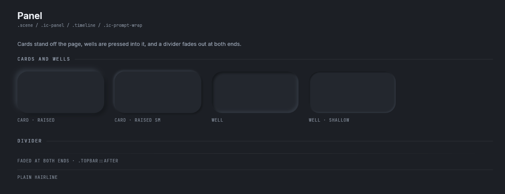

<details><summary>The Panel story in the light theme</summary>

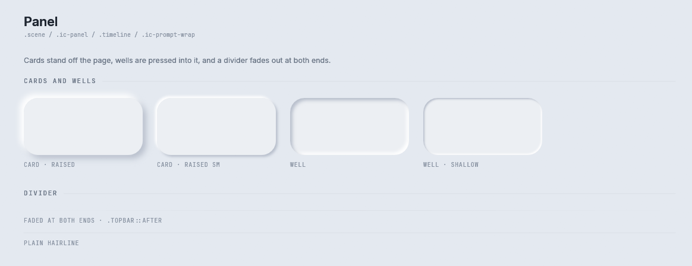

</details>

```rust
let inside = Panel::new().show(rux, card);          // raised, with 22 points of padding
let well = Well::new().radius(rux.theme().radius.xl).show(rux, inside);
```

A `Panel` is raised off the page and a `Well` is pressed into it. Both answer the rectangle inside
their padding, which is where their contents go. Neither has a `measure`, because a surface is as big as
the rectangle it is given.

| Builder | What it does |
|---|---|
| `Panel::new()` | `.scene`: radius `--r-xl`, padding 22 |
| `.kind(PanelKind)` | `Raised` (the default, `--e-raised`), `RaisedSmall` (`--e-raised-sm`), or `Flat` (`.ic-panel`, a hairline on the edge facing the page) |
| `.radius(f32)`, `.pad(Pad)`, `.fill(Color32)` | The corner radius, the padding and the fill |
| `Well::new()` | `.timeline`, `.ic-prompt-wrap`: `--e-pressed` |
| `.shallow()` | `--e-pressed-sm` |
| `.radius(f32)`, `.pad(Pad)`, `.fill(Color32)` | As for `Panel` |

`Divider::new().show(rux, rect)` draws a one point rule along the top of `rect`. `.faded()` fades it at
both ends, which is `.topbar::after`. `.colour(Color32)` sets its colour.

## SubGroup

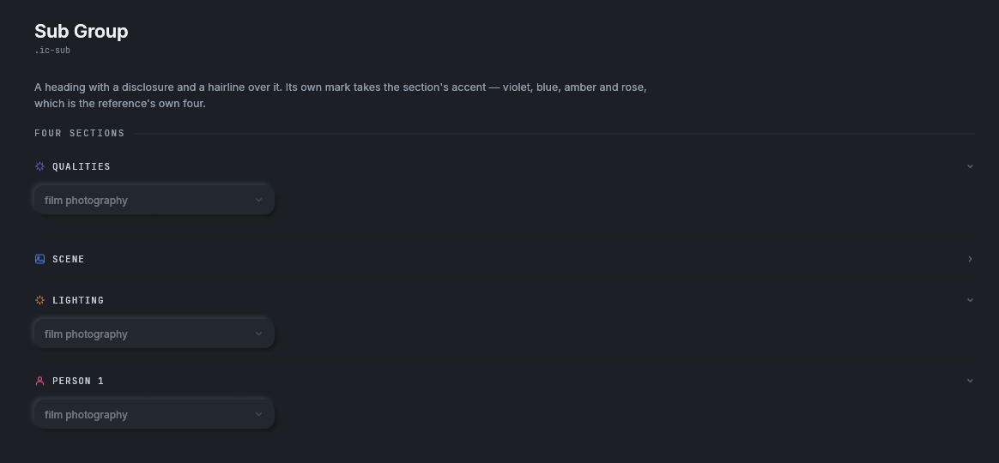

<details><summary>The Sub Group story in the light theme</summary>

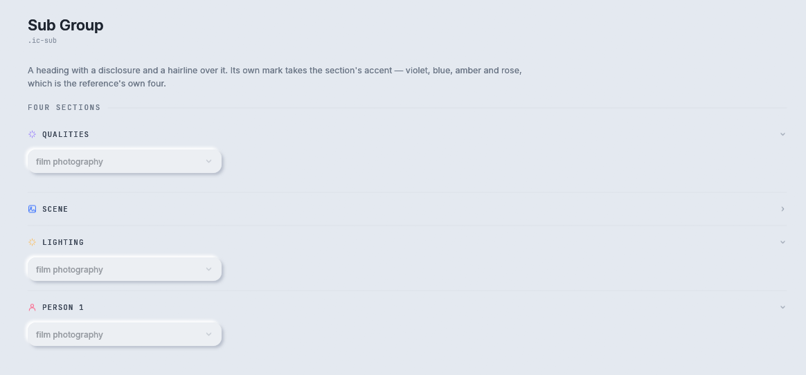

</details>

```rust
let group = SubGroup::new("Lighting", Icon::Spark, rux.theme().accent.amber, self.lighting_open);
let strip = pen.strip(group.head_height(rux) + if self.lighting_open { body_height } else { 0.0 });
let outcome = group.show(rux, strip);
if outcome.toggled {
    self.lighting_open = !self.lighting_open;
}
// draw the group's contents into outcome.body, which is empty when the group is shut
```

`.ic-sub`: a heading with a disclosure chevron and a hairline over it, in the mono face at 10.5 points,
uppercase. The mark takes the section's accent. `SubGroup::new(title, icon, accent, open)`;
`.first(true)` leaves out the hairline over the first group, which is `.ic-sub:first-of-type`.
`head_height(rux)` is 20 points on a desktop and the touch target on a phone.

## ListItem

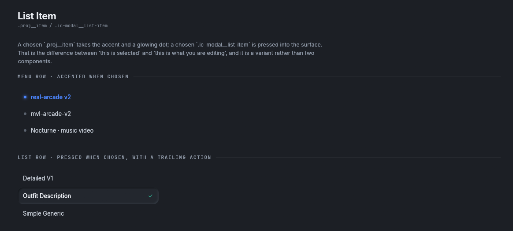

<details><summary>The List Item story in the light theme</summary>

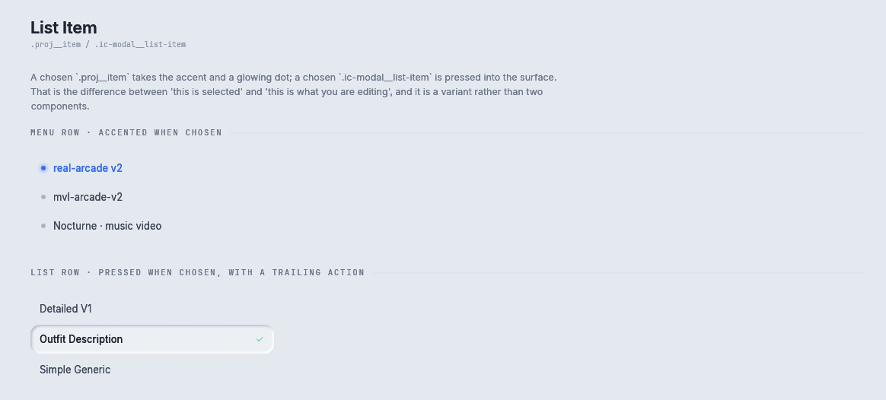

</details>

```rust
for (index, name) in self.projects.iter().enumerate() {
    let row = pen.strip(36.0);
    if ListItem::new(name, index == self.project).dot(true).show(rux, row).clicked {
        self.project = index;
    }
}
```

`.proj__item` and `.ic-modal__list-item` are the same row: a label, an optional leading dot, an optional
trailing action, and three states. A chosen `.proj__item` takes the accent, which means "this is
selected". A chosen `.ic-modal__list-item` is pressed into the surface, which means "this is what you are
editing". `.pressed_when_selected()` asks for the second.

| Builder | What it does |
|---|---|
| `ListItem::new(label, selected)` | Padding 10 by 14, `--r-md`, 13 point text |
| `.dot(bool)` | A leading dot, `.proj__item-dot` |
| `.tick(bool)` | A tick at the right of the chosen row |
| `.action(Icon, label)` | A trailing button, such as `.ic-modal__apply` |
| `.pressed_when_selected()` | The chosen row is pressed in instead of accented |
| `.pad(Pad)` | The padding |

`ListItemOutcome` has `clicked` (the row) and `action` (the trailing button instead of the row).

`menu_heading(rux, rect, text)` draws the small mono heading over a menu, `.proj__menu-head`.

## Chip

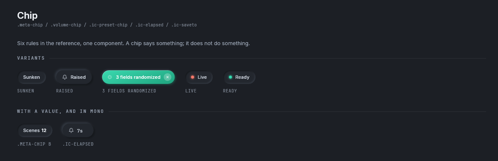

<details><summary>The Chip story in the light theme</summary>

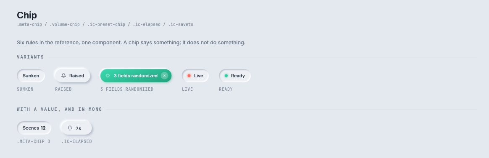

</details>

```rust
let chip = Chip::new("4 fields randomized").icon(Icon::Spark).variant(ChipVariant::Accent).dismissible(true);
let size = chip.measure(rux);
let (_, dismissed) = chip.show(rux, Rect::from_min_size(at, size));
if dismissed {
    self.clear_random_fields();
}
```

A small pill that says something. Six chips in the reference are one component: `.meta-chip`,
`.volume-chip`, `.scene__badge`, `.ic-elapsed`, `.ic-saveto` and `.ic-preset-chip`. What differs is the
depth, the fill, and whether it has a dot, a mark or a dismiss button.

| Builder | What it does |
|---|---|
| `Chip::new(label)` | A sunken chip |
| `.variant(ChipVariant)` | `Sunken` (a reading), `Raised` (`.ic-elapsed`, over a picture) or `Accent` (`.ic-preset-chip`, something that is on) |
| `.value(&str)` | A second, darker run of words, `.meta-chip b` |
| `.dot(Color32)` | A 7 point dot with a soft halo, `.volume-chip__dot` |
| `.icon(Icon)` | A mark |
| `.dismissible(bool)` | A round dismiss button at the right |
| `.mono(bool)` | The mono face |
| `.accent(Gradient)` | The gradient of an `Accent` chip. The default is mint |

`show` returns `(egui::Response, bool)`. The `bool` is true when the dismiss button was pressed.

## Avatar

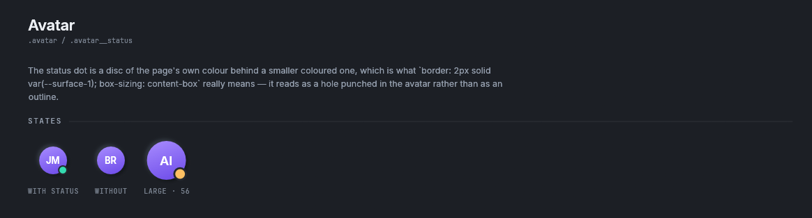

```rust
Avatar::new("JM").status(rux.theme().accent.mint).name("Jason").show(rux, rect);
```

`.avatar`: a 40 point round chip with a violet gradient and the person's initials, raised a little.
`.status(Color32)` adds a dot at the bottom right. The dot sits on a ring of the page's own colour, so it
reads as a hole punched in the avatar on any background. `.diameter(f32)` changes the size, and
`.name(&str)` is what a screen reader says.

## Tile

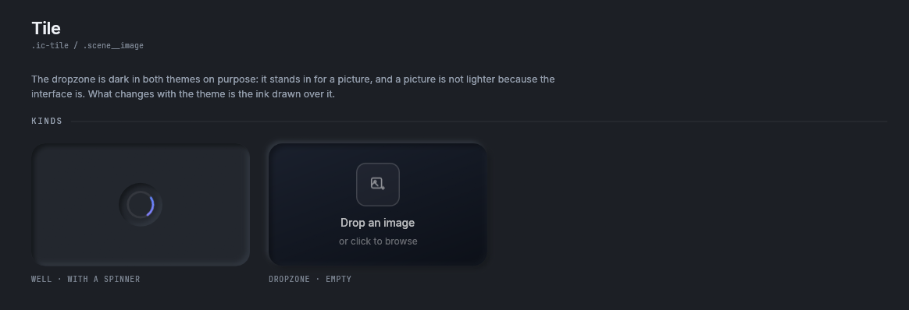

<details><summary>The Tile story in the light theme</summary>

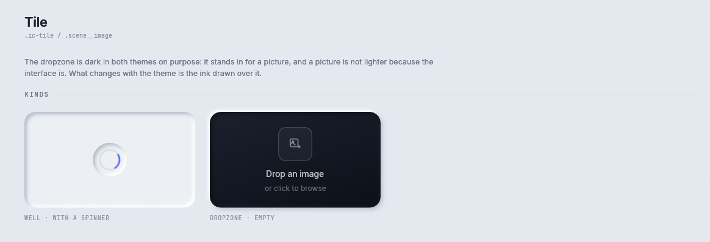

</details>

```rust
let height = Tile::height_at(width);                    // 16:9
let (response, inside) = Tile::new()
    .kind(TileKind::Dropzone)
    .empty_text("Drop an image", "or click to browse")
    .show(rux, Rect::from_min_size(at, Vec2::new(width, height)));
```

A box where a picture goes. `TileKind::Well` is `.ic-tile`, a pressed well a result appears in.
`TileKind::Dropzone` is `.scene__image`, a dark dropzone with a gradient, an outline and a hint.

The dropzone is dark in both themes. It stands in for a picture, and a picture is not lighter because
the interface is. What changes with the theme is the ink drawn over it.

`.image(TextureId)` draws a picture in the tile. `show` answers the response and the rectangle inside
the tile, where a caller draws a spinner or a chip over it.

## Scrollbar

```rust
let bar = Scrollbar::new(area, content_height);
offset = bar.grab(rux, offset);          // before the content, so it can take the drag
// draw the content, lifted by `offset`
bar.paint(rux, offset);                  // at the end, after the wheel has moved it
```

`.ic-panel__scroll::-webkit-scrollbar`: a 6 point thumb in `--surface-sunken` with no track. It is two
calls. `grab` takes the pointer at the same moment the scrolling area takes its own, because `egui` hands
a drag to the last widget that asked for the point. `paint` draws at the end, once the wheel and the
keyboard have moved the offset, because a thumb drawn from the offset the frame started with is a frame
behind the content. `needed()` says whether the content is taller than the area. On a phone the track is
14 points and the thumb 10.

## Where to go next

- [Dialogs](modal.md): the surface that sits over everything else.
- [Loaders](loaders.md): spinners and progress bars, which often sit in a `Tile`.
