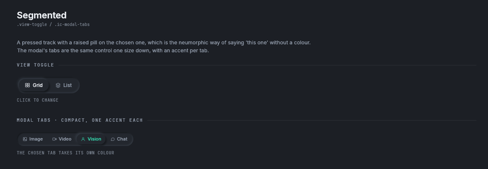
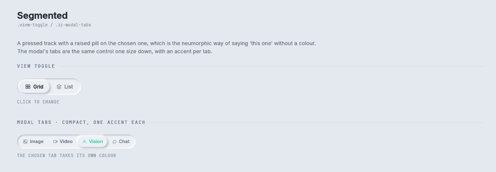
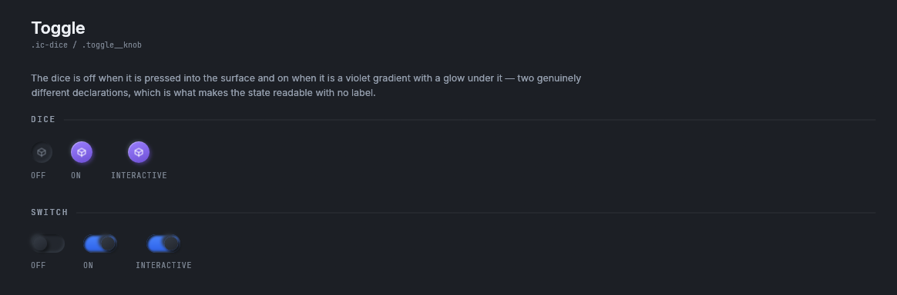
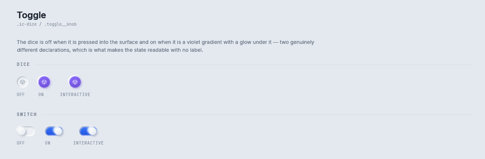

# Toggles

Three components that switch: `Segmented`, which chooses one of a few options, `DiceToggle`, a round
button that is on or off, and `Switch`.

Storybook: **Components → Segmented** and **Components → Toggle**.

## Segmented



<details><summary>The Segmented story in the light theme</summary>



</details>

```rust
const VIEWS: &[(&str, Option<Icon>)] = &[("Grid", Some(Icon::Storyboard)), ("List", Some(Icon::Layers))];

let control = Segmented::new(VIEWS, self.view);
let size = control.measure(rux);
if let Some(index) = control.show(rux, Rect::from_min_size(rect.min, size)).chosen {
    self.view = index;
}
```

`.view-toggle` and `.ic-modal-tabs` are the same control at two sizes: a pressed track with a raised pill
on the chosen option. That is how the neumorphic style says "this one" without a colour.

| Builder | What it does |
|---|---|
| `Segmented::new(&[(&str, Option<Icon>)], active)` | The options, each a word and an optional mark, and which is chosen |
| `.compact(bool)` | `.ic-modal-tabs`: padding 4, rows 6 by 10 at 11 points |
| `.accents(&[Color32])` | The chosen option takes its own colour, one for each option |

`SegmentedOutcome::chosen` is `Some(index)` in the frame an option was pressed.

## DiceToggle and Switch



<details><summary>The Toggle story in the light theme</summary>



</details>

```rust
if DiceToggle::new(self.randomise).label("Randomise genre").show(rux, rect).clicked() {
    self.randomise = !self.randomise;
}
if Switch::new(self.notify).label("Notify me").show(rux, rect).clicked() {
    self.notify = !self.notify;
}
```

Both answer an `egui::Response`. The application flips its own `bool` when the response is clicked.

`DiceToggle` is `.ic-dice`: a 28 point round toggle, sunken when off, and a violet gradient with a glow
when on. The example page puts one beside every select to say "pick this one at random".

| Builder | What it does |
|---|---|
| `DiceToggle::new(on)` | A toggle in this state |
| `.icon(Icon)` | The mark. The default is `Icon::Cube` |
| `.label(&'static str)` | The name a screen reader says |
| `.enabled(bool)` | Disabled or not |

`Switch` is the style guide's `.toggle__knob` with `--grad-knob`: a 44 by 24 point track with a knob.

| Builder | What it does |
|---|---|
| `Switch::new(on)` | A switch in this state |
| `.label(&'static str)` | The name a screen reader says |
| `.enabled(bool)` | Disabled or not |

`DiceToggle::SIZE` and `Switch::SIZE` are the drawn sizes. On a phone `measure` answers at least 44
points and the drawn size does not change.

## Where to go next

- [Agent-Chat parts](agent-chat.md#pillswitch): `PillSwitch`, the Agent-Chat design's version of a
  segmented control.
- [Instruments](instruments.md#key-and-checkbox): key caps that stay down when chosen.
