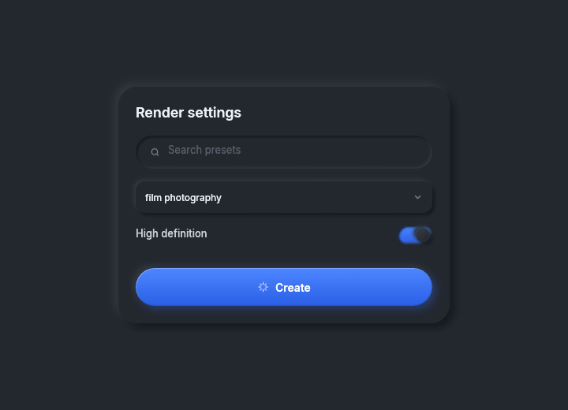
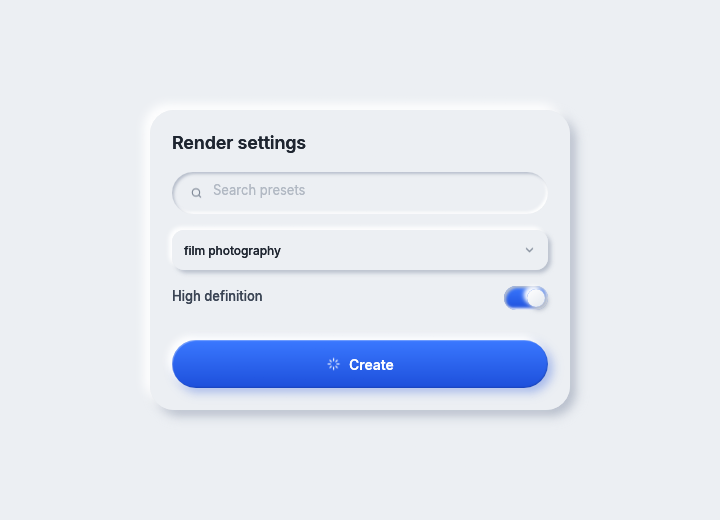

# Getting started

This page takes you from an empty `eframe` program to a window drawn with rux: adding the dependency,
the three calls every frame makes, and the shape every component has. It uses
`crates/rux/examples/first_window.rs`, which is a whole program you can run.

```sh
cargo run --release -p rux --example first_window
cargo run --release -p rux --example first_window -- light-neumorphic
```



<details><summary>The same window in the light theme</summary>



</details>

## Add the dependency

rux is not on crates.io. Depend on it by git, pinned to a commit, beside the `egui` and `eframe`
versions it is built for:

```toml
[dependencies]
rux = { git = "https://github.com/Black-Rainbow-Labs/black-rainbow-labs-rux.git", rev = "<commit>" }
egui = "0.36"
eframe = { version = "0.36", default-features = false, features = ["wgpu", "default_fonts", "accesskit"] }
```

Keep `accesskit` on. Every rux control names itself for a screen reader, and without `accesskit` none of
those names reaches Narrator, VoiceOver or UI Automation.

Do not turn on `vello_cpu`'s `multithreading` feature anywhere in the build.
[Repository](repository.md#versions-that-have-to-match) explains why.

## Once, before the first frame

```rust
use rux::prelude::*;

rux::text::install(ctx);                                         // the seven faces
let state = RuxState::new(Theme::named("dark-neumorphic").unwrap());
```

`rux::text::install` registers Inter and JetBrains Mono with `egui`. `RuxState` is what rux keeps between
frames: the theme, the decoration canvases, the icon atlas, the screen and the zoom. The application owns
it. A program can have more than one.

`rux::prelude` brings in every component, `Icon` and `Mark`, the layout types, `Style`, the screen types,
`Rux`, `RuxState` and `Theme`.

## Every frame

```rust
impl eframe::App for App {
    fn ui(&mut self, ui: &mut egui::Ui, _frame: &mut eframe::Frame) {
        let area = ui.max_rect();
        rux::layer(ui, &self.rux, egui::Id::new("page"), area, |rux| self.page.draw(rux, area));
        self.rux.end_frame();
    }
}
```

1. **`rux::layer`** reserves a place behind everything for the layer's decoration, hands the closure a
   `Rux`, and fills the place in with the decoration once the closure returns.
2. **The closure draws.** It starts with `rux.ground(area)`, which paints the page colour into the
   decoration. Painting the ground with `egui` instead would cover every shadow.
3. **`end_frame`** drops the canvases of layers that were not drawn this frame, such as a menu that just
   closed.

`App` keeps the `RuxState` and the page's own state in two fields. `rux::layer` borrows the `RuxState`
for the whole frame while the page is drawn with `&mut`, and two fields let the closure borrow both. The
storybook is built the same way.

A phone application also calls `state.set_screen(Screen::phone(size, insets))` once a frame before
`rux::layer`. See [Mobile](mobile.md).

## Draw a page

```rust
fn draw(&mut self, rux: &mut Rux<'_>, area: egui::Rect) {
    rux.ground(area);
    let card = egui::Rect::from_center_size(area.center(), egui::vec2(420.0, 300.0));
    let inside = Panel::new().show(rux, card);
    let title = rux.text(Style::H3, "Render settings", rux.theme().ink.i900);
    let [heading, search, select, switch_row, button_row] = Flex::column(inside)
        .gap(16.0)
        .fixed(title.size().y)
        .fixed(42.0)
        .fixed(40.0)
        .fixed(24.0)
        .fill(1.0)
        .solve();
    rux.ui.painter().galley(heading.left_top(), title, rux.theme().ink.i900);

    TextInput::search(&mut self.query).hint("Search presets").show(rux, search);

    let outcome = Select::new(&self.styles, self.style).label("Style").show(rux, select, &mut self.style_menu);
    if let Some(index) = outcome.chosen {
        self.style = Some(index);
    }
    // the switch row and the button follow
}
```

Four things to see in it:

- **A component draws into the rectangle it is given.** `Flex::column(inside)` divides the panel into
  five rectangles, and each control is shown into one. [Layout](layout.md) covers `Flex`, `Grid`, `Pen`
  and `Pad`.
- **A component answers what happened.** `TextInput::show` returns a `TextInputOutcome`,
  `Select::show` returns a `SelectOutcome`, and `Button::show` returns an `egui::Response`.
- **State is the caller's.** The text in the field, the chosen style, and whether the menu is open are
  fields of `Page`. `Select` takes `&mut self.style_menu`, a `SelectState`, so two selects on one screen
  open separately.
- **Colours come from the theme.** `rux.theme().ink.i900` is the strongest ink in whichever theme is
  active. A program never needs a colour of its own to sit beside rux.

## The shape every component has

```rust
let create = Button::new("Create").primary().icon(Icon::Spark).size(ButtonSize::Large);
let wanted: egui::Vec2 = create.measure(rux);   // what it wants, before anything places it
let response = create.show(rux, rect);          // draws into the rectangle it is given
```

Builder methods take `self` and return `Self`. `measure` takes `&self`, so the same value is measured and
then shown. A few components answer their height for a width instead, such as `Chart::height_at(rux,
width)`, and surfaces like `Panel` have no `measure` because they are as big as the rectangle they are
given.

Every component keeps three rules:

1. It decides nothing about the application. It draws, and it answers what happened.
2. It reads the theme and never a colour.
3. It sets the cursor the stylesheet sets: a pointing hand on something pressable, a text cursor on a
   field.

## Changing the theme while running

```rust
self.rux.set_theme(Theme::named("light-neumorphic").unwrap());
```

The next frame draws every layer again in the new colours. [Themes](themes.md) lists every token, and
explains how to make a theme from another application's colours with `Theme::retoned`.

## Look at every component

```sh
cargo run --release -p rux-storybook
```

The storybook shows every component in every state, live, in both themes. The theme picker is at the top
left and the filter is under it. [Components](components/README.md) is the same list, with pictures and
the API for each.

## Where to go next

- [Components](components/README.md): every component.
- [How rux draws](architecture.md): why the frame is built this way, and what a frame costs.
- [Glossary](glossary.md): the words these pages use.
