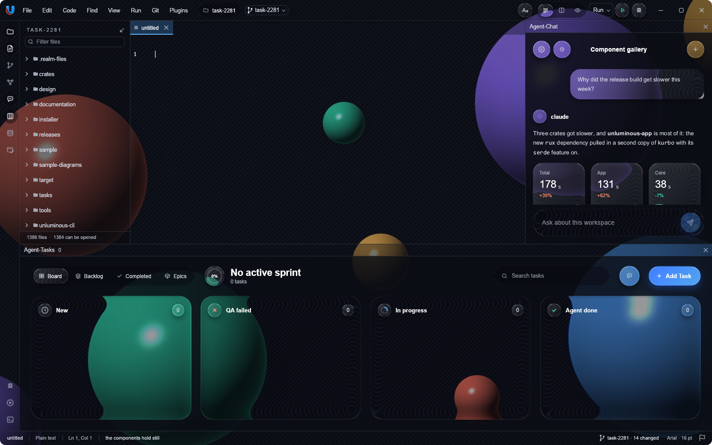

# Glass



A glazed theme draws every raised surface as glass that **bends** the picture behind the window, the
way a lens does, instead of blurring it or hiding it. The edges pull the picture in, the middle magnifies
it, and red, green and blue are bent by slightly different amounts, so an edge carries a faint colour
split. Over the bent picture each surface keeps a light tint, a lit top edge, a hairline rim and a long
soft shadow. Carved wells are a dark tint with no bend.

It came from a Claude Design canvas ("Unluminous", page "Agent-Chat 2"), which builds it in a browser
with an SVG backdrop filter per element. rux draws the same arithmetic with `egui` meshes, so it costs a
texture fetch per pixel on the graphics card and works anywhere egui draws, offscreen tests included.

## Making a theme glass

```rust
let dark = Theme::named("dark-neumorphic").unwrap();
let glass: &'static Theme = Box::leak(Box::new(dark.glazed("my-glass", my_pane_colour)));
state.set_theme(glass);
```

`Theme::glazed` keeps the theme's ink and accents and replaces the surfaces, the shadows and
`theme.chat` with the glass design's: the card is a white sheen over a smoke, the well is
`rgba(6, 8, 14, 0.42)`, and the raised elevations are the design's long fall and lit edges. It sets
`theme.glass` to `Glass::DESIGN`, the numbers the bend is made of. The two shipped themes have
`glass: None`, so nothing changes for a program that does not ask for it.

This is the one place a theme changes a recipe rather than a value. Glass is a material, and the design
draws depth with a fall and lit edges where neumorphism draws it with a light shadow and a dark one.

## Giving glass something to bend

Glass bends a picture the application hands over. egui draws every layer into one render pass and cannot
read back what it has already drawn, so glass cannot sample whatever happens to be under it.

```rust
rux::render::set_backdrop(ctx, Plane::Page, Some(Backdrop {
    bands: picture_strips,          // the picture's textures, top to bottom
    rect: window_rect,              // where the picture is drawn, in the window's points
    uv: shown_part,                 // which part of the picture is drawn there
    opacity: 1.0,                   // how much of what is behind the picture covers
}));
```

Set it once a frame, before anything draws. `Plane::Page` is what layers in egui's background and middle
orders bend. `Plane::Above` is what popups and modals bend, and falls back to the page's picture when it
is not set. Unluminous sets `Above` to the blurred photograph of the window a modal takes, which gives a
frosted modal whose glass bends the window's own contents. `Backdrop::single` is a picture held as one
texture. A picture held as several strips, which a large picture should be so a graphics driver never
keeps one large upload's staging memory, is a list of `Band`s.

With no backdrop set, glass is its tint and its edges and nothing is bent.

## Which surfaces are glass

`Chrome::surface` decides, so no component asks. A surface is glass when the theme is glazed, the
surface has a shadow outside it (it is raised) and its fill is translucent. An opaque fill hides the
picture anyway, and a carved well has no outer shadow. A layer with glass in it is cut at each piece of
glass: the decoration before it is one texture, the bent picture is drawn, and the decoration after it is
another texture. That is what puts a carved track over the card it is carved into and under the pill
raised out of it.

`render::glass::shapes` is public, for an application that paints a surface with egui directly and wants
it to be glass too. Unluminous uses it for egui's own popup frames and for its canvas nodes.

## The lit edges are faint

The rim and the top highlight of a glass surface are a few percent of white: 7% for a card's rim and 9%
for its top edge, 5% to 7% for a carved track. The first version used the design's own values, about
twice that, and over a dark picture each card and button had a white line along its top that stood out
from everything around it. Jason asked for them to blend in (task-2281, second pass). The values are in
`Chat::glass` and the `glass_*` elevations in `theme/tokens.rs`.

## What it costs

A piece of glass is about four hundred vertices, drawn three times, one for each colour channel. The
shapes are kept per layer and built again only when the surface, the picture or the layer's transform
moves, so a still frame builds nothing. Measured in Unluminous while scrolling its chat pane, egui's own
time per frame went up by about 0.4 ms against the same pane in the dark theme.

## What it does not do

- Glass inside glass bends the picture, not the glass under it. A browser bends the parent's already bent
  picture; doing that needs the frame read back.
- The desktop behind a transparent window is not a picture rux can read, so glass over it is tint only.
- There is no light glass. The design is dark.
