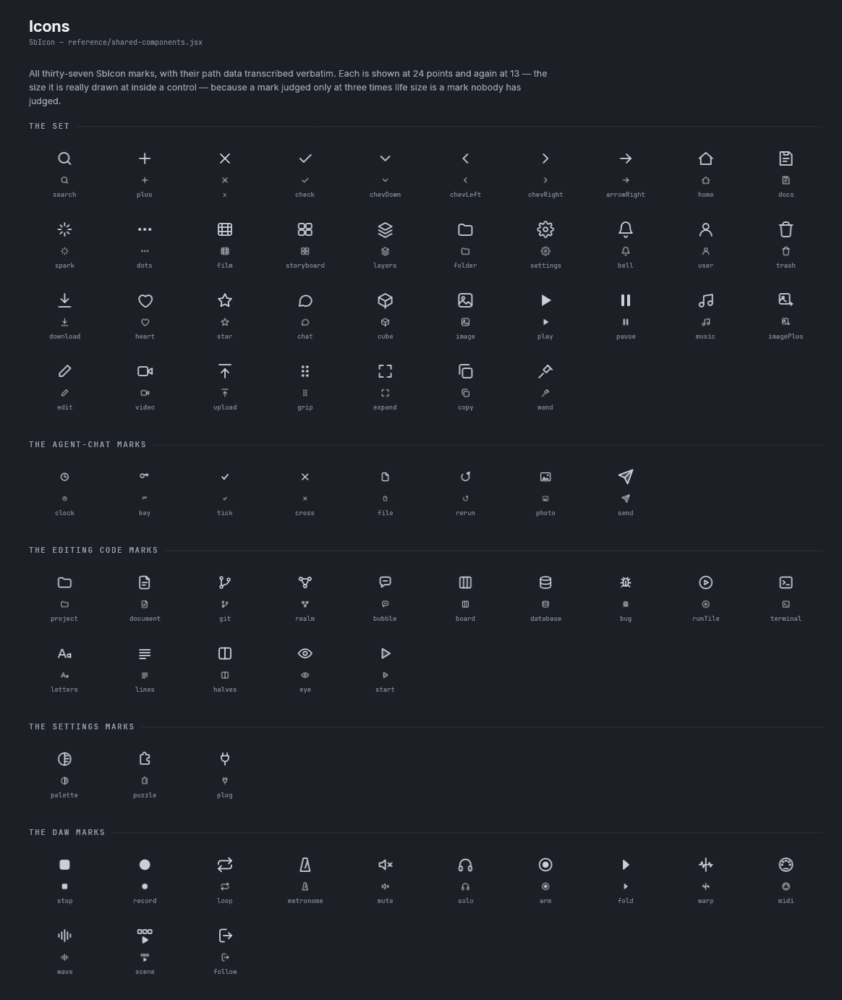
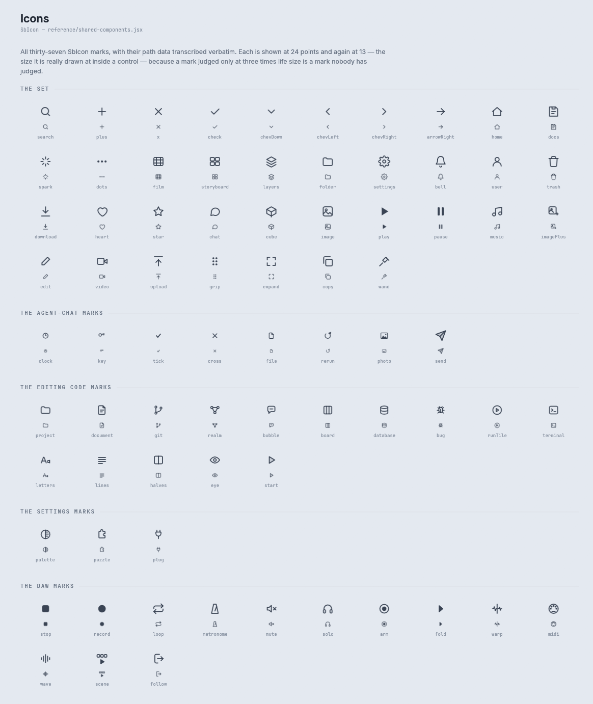

# Icons

rux draws 76 marks. Thirty seven are the AI Studio `SbIcon` set, eight came with the Agent-Chat design,
fifteen with the Editing code design, three with the Settings design and thirteen with the DAW set. Every mark's SVG path data is
copied exactly from its source.

Storybook: **Foundations → Icons**. The sheet draws every mark at 24 points and again at 13 points, the
size it is drawn at inside a control, because a mark judged only at a large size hides the faults that
show at the size a person sees.



<details><summary>The icon sheet in the light theme</summary>



</details>

## Drawing a mark

```rust
let ink = rux.theme().ink.i700;
rux.mark_in(Mark::new(Icon::Settings, 16.0), rect, ink);          // centred in a rectangle
rux.mark(Mark::new(Icon::Send, 18.0).stroke(1.8), centre, ink);   // centred on a point
```

Most components take an `Icon` directly: `Button::icon`, `IconButton::new`, `Chip::icon`,
`SubGroup::new`. Use `Rux::mark` and `Rux::mark_in` when drawing a mark of your own.

| `Mark` method | What it does |
|---|---|
| `Mark::new(icon, size)` | The mark drawn `size` points square |
| `.stroke(f32)` | The stroke width, in the mark's own view box units. Each mark has the stroke its source sets, from `Icon::stroke` |
| `.turn(radians)` | Rotate it |
| `.flipped()` | Turn it half way round, such as a chevron pointing the other way |

## The sets

| Constant | Marks | Source |
|---|---|---|
| `Icon::ALL` | 37: `Search`, `Plus`, `X`, `Check`, `ChevDown`, `ChevLeft`, `ChevRight`, `ArrowRight`, `Home`, `Docs`, `Spark`, `Dots`, `Film`, `Storyboard`, `Layers`, `Folder`, `Settings`, `Bell`, `User`, `Trash`, `Download`, `Heart`, `Star`, `Chat`, `Cube`, `Image`, `Play`, `Pause`, `Music`, `ImagePlus`, `Edit`, `Video`, `Upload`, `Grip`, `Expand`, `Copy`, `Wand` | `SbIcon` in `reference/shared-components.jsx` |
| `Icon::CHAT` | 8: `Clock`, `Key`, `Tick`, `Cross`, `File`, `Rerun`, `Photo`, `Send` | Unluminous's window marks, and the canvas's paper airplane (task-2235) |
| `Icon::WINDOW` | 15: `Project`, `Document`, `Git`, `Realm`, `Bubble`, `Board`, `Database`, `Bug`, `RunTile`, `Terminal`, `Letters`, `Lines`, `Halves`, `Eye`, `Start` | the Editing code page of the design canvas: the rail, the text options, the three view modes and the run triangle (task-2241) |
| `Icon::SETTINGS` | 3: `Palette`, `Puzzle`, `Plug` | the Settings page of the design canvas (task-2246) |
| `Icon::DAW` | 13: `Stop`, `Record`, `Loop`, `Metronome`, `Mute`, `Solo`, `Arm`, `Fold`, `Warp`, `Midi`, `Wave`, `Scene`, `Follow` | transport and mixer marks for a digital audio workstation, drawn in the same 24 point grid at the default stroke (task-2344) |

`Icon::every()` walks all five sets. `icon.name()` answers the name the sheet prints, and `Icon::named(name)` finds a mark by that name. `Icon::ALL` stays
exactly `SbIcon`'s set, and `tests/reference.rs` checks every name in it against the source.

## How a mark is drawn

A mark is a tinted texture. The atlas rasterises a mark once for each size, stroke and pixel density into
an alpha mask of one byte a pixel, with `vello_cpu`, and every use of that mark at that size shares it.
Drawing a mark in a colour is a textured rectangle with that vertex colour.

That matters because the reference changes an icon's colour on hover in nineteen rules. If marks were
decoration, every one of those hovers would rasterise the whole layer. As textures, a hover costs a
vertex colour.

Two tests keep a copying mistake from shipping: `every_icon_s_path_data_parses` and
`every_mark_stays_inside_its_own_view_box`.

## Adding a mark

1. Add the variant to `enum Icon` in `crates/rux/src/icon/paths.rs`, beside the set it belongs to.
2. Copy its SVG path data exactly, with the stroke its source sets.
3. Add it to the right set constant, or to a new set and to `Icon::every()`.
4. Add the set to the icon sheet in `storybook/src/stories/foundations.rs` if it is new.
5. Run `cargo test -p rux`, then `pwsh tools/capture-docs.ps1 -Stories Icons` and look at the mark at 13
   points.
