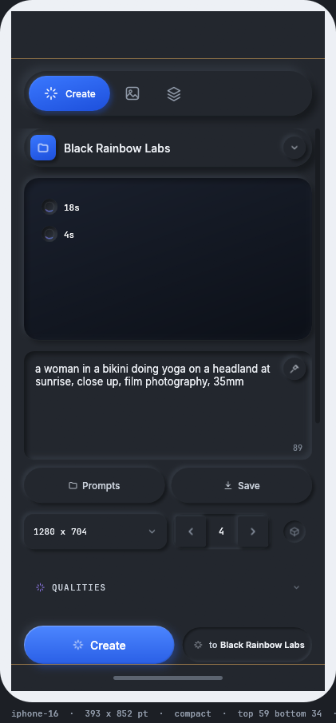
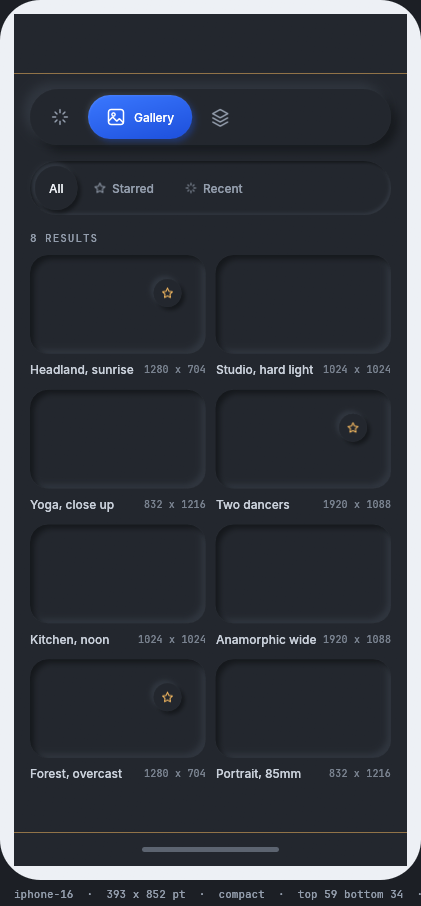
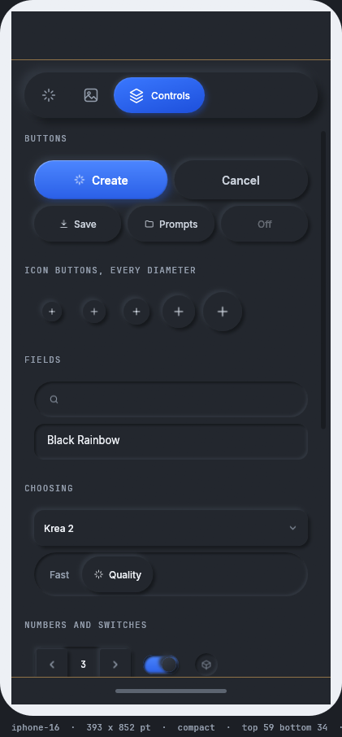
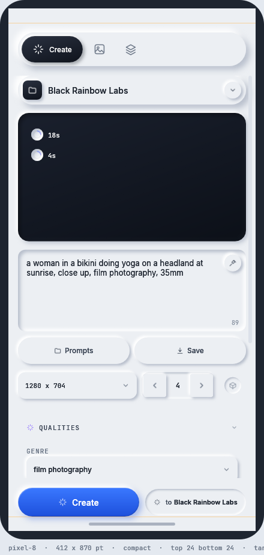
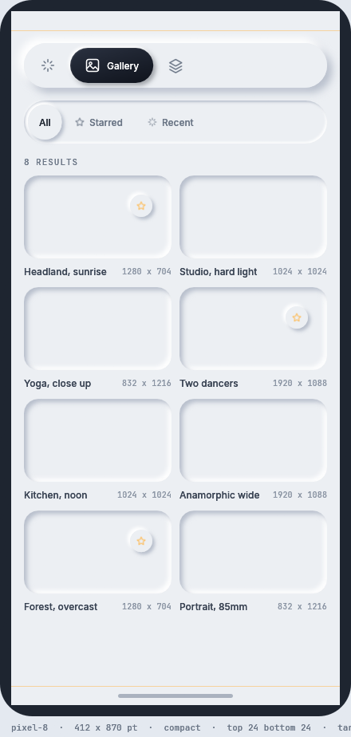
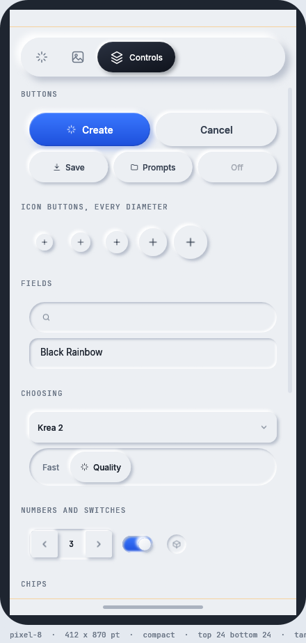

# Mobile

rux runs on iOS and Android with the same components and the same themes it uses on a desktop.
`mobile/` holds a working example: one application crate with no platform code in it, three shells that
turn it into a program, and a desktop preview that shows it inside a phone frame at a real phone's size.

This page covers what a component does differently on a phone, how to see the application on a
desktop, and how to build it for each platform. The full design is `tasks/task-2032-rux-mobile-tdd.md`,
and the Android shell is described in `mobile/android/README.md`.

<table>
<tr>
<td></td>
<td></td>
<td></td>
</tr>
<tr>
<td></td>
<td></td>
<td></td>
</tr>
</table>

The three screens of the example application, in the mobile preview: Create, Gallery and Controls, on an
iPhone 16 in the dark theme and a Pixel 8 in the light theme.

## Tell rux what the device is

An application says what device it is on once a frame, before anything draws:

```rust
state.set_screen(Screen::phone(size, insets));   // a phone: a finger, these safe area insets
state.set_screen(Screen::desktop(size));         // a desktop: a mouse, no insets
state.set_screen(Screen::read(ctx));             // read it from egui, for a desktop program
```

`Screen::read` is for a desktop program that might run on a touch screen. A program that knows it is on
a phone calls `Screen::phone`. `egui` only reports a touch screen after the first touch, so with
`Screen::read` a phone's first frame is laid out for a mouse and every control grows a frame later.

`Screen` holds three facts and nothing else: how wide the screen is, what covers its edges, and whether
the pointer is a finger. A component reads it through `rux.screen()` and decides its own size. Nothing
in `mobile/app` asks which platform it is on.

`Screen::desktop` is exactly how rux behaved before it knew about phones: a mouse, no insets, and a
minimum target of zero. An application that never calls `set_screen` gets `Screen::default()`, which is
a desktop. `crates/rux/tests/touch.rs` checks every desktop measurement against the number it was before
`Screen` existed.

| `Screen` method | What it answers |
|---|---|
| `class()` | `SizeClass::Compact` under 600 points, `Medium` under 840, `Expanded` above |
| `is_compact()` | whether the size class is `Compact` |
| `min_target()` | 44 points for a finger, 0 for a mouse |
| `target_height(height)` | `height`, raised to `min_target()` |
| `safe(rect)` | `rect` with the safe area insets taken off |
| `with_pointer(pointer)`, `with_insets(insets)` | a copy with one fact changed |

## What a component does differently

| Component | With a finger | On a compact width |
|---|---|---|
| `Button` | at least 44 points tall | |
| `IconButton` | at least 44 points of layout, the circle drawn at its own size | |
| `Select` | the trigger and the menu rows at least 44 points | the menu opens as a sheet from the bottom edge, full width |
| `Modal` | the close button grows from 32 to 44 points | a sheet: full width less 12 points, anchored to the bottom, top corners rounded, with a grabber |
| `TextInput`, `TextArea`, `Stepper`, `Switch`, `DiceToggle`, `Segmented`, `Chip`, `ListItem` | at least 44 points | |
| `TopNav` | items at least 44 points tall | fits the width it is given: it drops the chosen item's label, then trims the item padding to 10 points |
| `Scrollbar` | a 14 point track and a 10 point thumb | |

`Modal::present(Present::Sheet)` asks for a sheet on any screen. A modal on a compact screen is a sheet
without being asked. `Select`'s compact menu uses the same frame, so the two look like one idea.

### A touch target grows the layout box

On a phone a control's `measure` answers at least 44 points, and what is drawn does not change. A 28
point circle stays a 28 point circle, centred in a 44 point box.

The other way to do it is to keep the layout and widen only the rectangle handed to `egui` for input.
That fails: two 28 point circles six points apart then claim 44 point targets that overlap by ten
points, and `egui` gives an overlapping point to whichever widget asked last, so the second circle takes
a strip of the first one's target. Growing the layout cannot do that, because the layout keeps controls
apart.

### A finger does not hover

`Visual::of` takes the pointer, and `Pointer::Touch` never answers `Hover`. `egui` keeps a touch's last
position after the finger lifts, so without this the hover wash would stay on whatever was last tapped.
Nineteen rules in the reference change a colour on `:hover`, and this is the one place that decides
whether any of them apply.

## See it on a desktop

```sh
cargo run --release -p rux-mobile-preview
cargo run --release -p rux-mobile-preview -- --device iphone-se --theme light-neumorphic
cargo run --release -p rux-mobile-preview -- --list
```

| `--device` | Size in points | Safe area |
|---|---|---|
| `iphone-16` | 393 × 852 | top 59, bottom 34 |
| `iphone-16-pro-max` | 440 × 956 | top 62, bottom 34 |
| `iphone-se` | 375 × 667 | top 20, bottom 0 |
| `pixel-8` | 412 × 870 | top 24, bottom 24 |

`--screen create`, `gallery` or `controls` opens one screen, and `--wide` opens the expanded size class.
The preview draws the safe areas in the frame, so a control under the Dynamic Island or the home
indicator is easy to see. `pwsh tools/capture-mobile.ps1` photographs every screen on every device in
both themes.

## Build for a phone

| | Builds on Windows | Runs on Windows | Runs on a device |
|---|---|---|---|
| `mobile/preview` | yes | yes | |
| `mobile/android` | yes | yes, on the emulator | yes |
| `mobile/ios` | yes, including the link and the signature | no, there is no iOS Simulator for Windows | needs a device and a way to install |

```powershell
pwsh mobile/android/build-android.ps1                    # build, install on what is attached, launch
pwsh mobile/android/build-android.ps1 -Capture out.png   # and photograph the screen
pwsh mobile/ios/build-ios.ps1                            # compile, link, bundle and sign, on Windows
```

**Android.** `cargo ndk` cross compiles `mobile/app` for `arm64-v8a` and `x86_64`, Gradle packages it
and `adb` installs and starts it. The shell is a `GameActivity` with a small Kotlin class,
`RuxActivity`, that draws edge to edge, reports the system bar, cutout and keyboard insets, passes the
soft keyboard's text to Rust, and routes the back gesture. `rux-android` (`mobile/android/shell`) is the
Rust half, and another application can depend on it by path. It needs the Android SDK with an NDK, and
JDK 17 or newer.

**iOS.** `build-ios.ps1` compiles for `aarch64-apple-ios`, links a real arm64 Mach-O against an
iPhoneOS SDK's stubs with `zig` as the linker, writes the `.app` and signs it with `rcodesign`. No Mac is
involved. Installing and running it needs a phone. The SDK is not in this repository, and
`mobile/ios/README.md` says where to get one.

## Why there is no second renderer

`eframe` 0.36 supports iOS and Android. `egui-winit` reads `UIWindow.safeAreaInsets` on iOS, and
`eframe` has `android-native-activity` and `NativeOptions::android_app`. So the phone runs the same
`eframe::App` the storybook runs, over the same rux.

## What is not built yet

- **On iOS the field is not moved above the keyboard.** Typing works, because winit's view takes the
  keyboard when `egui` asks for text. iOS reports the keyboard's height only through notifications, and
  nothing reads them yet. On Android the keyboard's height is reported and treated as a bottom inset.
- **A tablet layout.** `SizeClass::Medium` and `Expanded` are reported. Past the compact width the
  example keeps a readable column and centres it.
- **Platform gestures** other than back: long press and pinch.
- **Dynamic type**, which would scale the type scale that `tests/reference.rs` checks at fixed sizes.
- **Signing for the App Store and the Play Store.**

## Where to go next

- [Components](components/README.md): every component, including the ones the screens above use.
- `mobile/README.md`: the crate types, and why each shell is its own crate.
