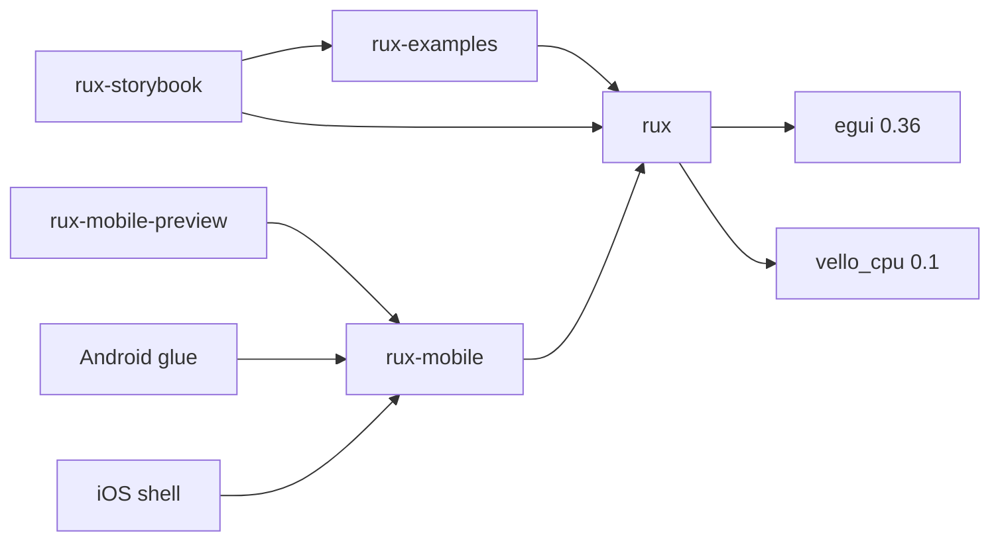

# Repository and building

This page lists the crates in the workspace and what each one does, the commands to build and run
them, and the conventions a change has to follow. `CLAUDE.md` in the repository root is the longer
version of the conventions, written for whoever changes the code next.

## The crates

```
crates/rux/             rux, the library, and the only crate a program depends on
examples/               rux-examples: the Image Creator page, rebuilt from the components
storybook/              rux-storybook: every component in every state, both themes
mobile/app/             rux-mobile: the mobile application, with no platform code in it
mobile/preview/         rux-mobile-preview: the mobile application inside a phone frame, on a desktop
mobile/android/glue/    the Android cdylib that GameActivity loads
mobile/android/shell/   rux-android: insets, the soft keyboard and the back gesture for any rux app
mobile/ios/             the iOS staticlib and bin, and the build that makes a signed .app
mobile/ios/zig-ios-cc/  the linker wrapper that lets rustc link Mach-O on Windows
reference/              the stylesheets and source the original components were copied from
tasks/                  the design documents
tools/                  the capture scripts
docs/                   these pages, and the pictures in docs/images/
```



The dependencies point one way. `rux` depends on `egui`, `vello_cpu` and `kurbo`, and on nothing in this
repository. So a program depends on `rux` alone, and nothing in the storybook or the example page can
add anything to the library.

## Building and running

```sh
cargo build --release
cargo test -p rux

cargo run --release -p rux-storybook
cargo run --release -p rux-storybook -- --theme light-neumorphic --story "Chat Parts"
cargo run --release -p rux-storybook -- --list
cargo run --release -p rux-storybook -- --help

cargo run --release -p rux-mobile-preview -- --device iphone-16
```

The workspace needs Rust 1.85 or newer. A release build of the storybook is about 18 MB.

`rux-storybook --measure` shows what the library is holding along the bottom of the sidebar: canvases,
their pixels, icon marks, and how many times anything has been rasterised since the window opened.

## The tools

| Script | What it does |
|---|---|
| `tools/capture-window.ps1` | Photographs one window by process id or title, without bringing it to the front |
| `tools/capture-stories.ps1` | Photographs every story in both themes into `_agent_output/` |
| `tools/capture-docs.ps1` | Takes every picture in `docs/images/`: each story whole, cropped to the story |
| `tools/capture-mobile.ps1` | Photographs every mobile screen on every device in both themes |

All four are PowerShell 7 scripts for Windows. A build with `CARGO_TARGET_DIR` set is found there.

## The conventions

These are the rules every component follows. `CLAUDE.md` says why each one exists.

1. **A component decides nothing about the application.** It draws, and it answers what happened. State
   that has to survive a frame belongs to the caller and is passed in by `&mut`. That is what lets the
   same component appear twice on one screen, and it is why `Select` takes a `&mut SelectState`.
2. **A component reads the theme and never a colour.** There is no `Color32::from_rgb` anywhere in
   `components/`. A colour the theme does not have is a change to `Theme`, to both themes and to
   `tests/reference.rs`, in one commit.
3. **A component sets the cursor the stylesheet sets.** `cursor: pointer` is
   `CursorIcon::PointingHand`, `cursor: text` is `CursorIcon::Text`, `cursor: grab` is
   `CursorIcon::Grab`.
4. **A number comes from a declaration, and the comment beside it names the rule.**
   `// .ic-count { width: 66px }` is how the next reader checks the number.
5. **Anything that changes every frame stays out of the `Decor` list.** See
   [How rux draws](architecture.md#the-rule-anything-that-changes-every-frame-stays-out-of-the-decor-list).
6. **Every popup is its own layer.** Use `Rux::overlay`.
7. **A component that gains a drawing path goes in `tests/draw.rs`.**
8. **A change that alters what a component looks like updates its page in `docs/components/` and its
   pictures in the same commit.** See [Writing style](writing-style.md#keeping-pages-correct).

### Where the parts come from

The original nineteen components, the two themes and the first thirty seven icons were copied from the
AI Studio design in `reference/`, and `tests/reference.rs` checks them against it.

The parts Unluminous uses for its chat pane, its task board, its editor and its Settings window were
drawn to the Claude Design canvas "Unluminous" instead:

| Canvas page | Source files | Ticket |
|---|---|---|
| Agent-Chat | `components/round.rs`, `status.rs`, `dial.rs`, `cards.rs`, `answer.rs` | task-2235 |
| Agent-Tasks | `components/board.rs` | task-2241 |
| Editing code | the rail, view mode and run marks in `icon/paths.rs` | task-2241 |
| Settings | the palette, puzzle and plug marks in `icon/paths.rs` | task-2246 |

The instrument controls in `components/instrument.rs`, `key.rs`, `fader.rs`, `chart.rs` and
`table.rs` were added for Unluminous's chat answers in task-2211. They have no rule in the reference.
Every colour in them is worked out from the theme's own surfaces, shadows, ink and accents.

### Versions that have to match

- **`vello_cpu` is 0.1 because `epaint` 0.36 uses 0.1.** Follow `epaint` when `egui` is next upgraded.
- **`vello_cpu`'s `multithreading` feature stays off.** It changes `epaint`'s settings too, and
  `epaint`'s glyph rasteriser then panics.
- **`eframe` keeps its `accesskit` feature.** Every control names itself for a screen reader through
  `Response::widget_info`, and without `accesskit` none of those names reaches Narrator, VoiceOver or
  UI Automation.

## Using rux from another repository

rux is not published to crates.io. A program depends on it by git, pinned to a commit:

```toml
[dependencies]
rux = { git = "https://github.com/Black-Rainbow-Labs/black-rainbow-labs-rux.git", rev = "<commit>" }
egui = "0.36"
eframe = "0.36"
```

Unluminous does exactly this. Pin a `rev` so a change here reaches the program only when the program
moves its pin.

## Licence

rux is dual licensed under the MIT licence (`LICENSE-MIT`) and the Apache licence 2.0
(`LICENSE-APACHE`). The vendored faces, Inter and JetBrains Mono, are both under the SIL Open Font
License, and their licences are in `crates/rux/assets/fonts/`.
