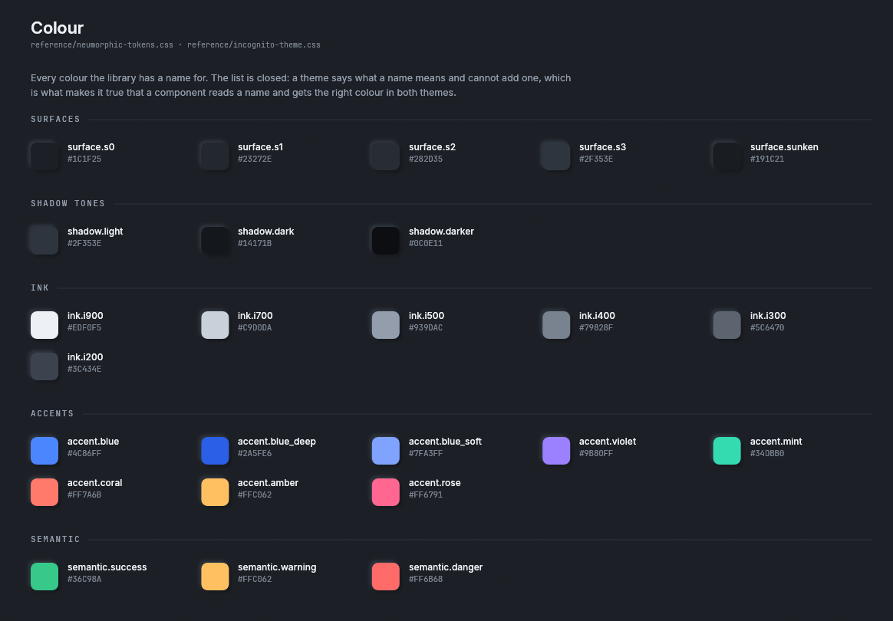
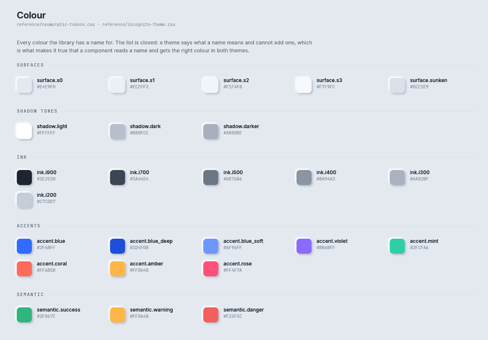
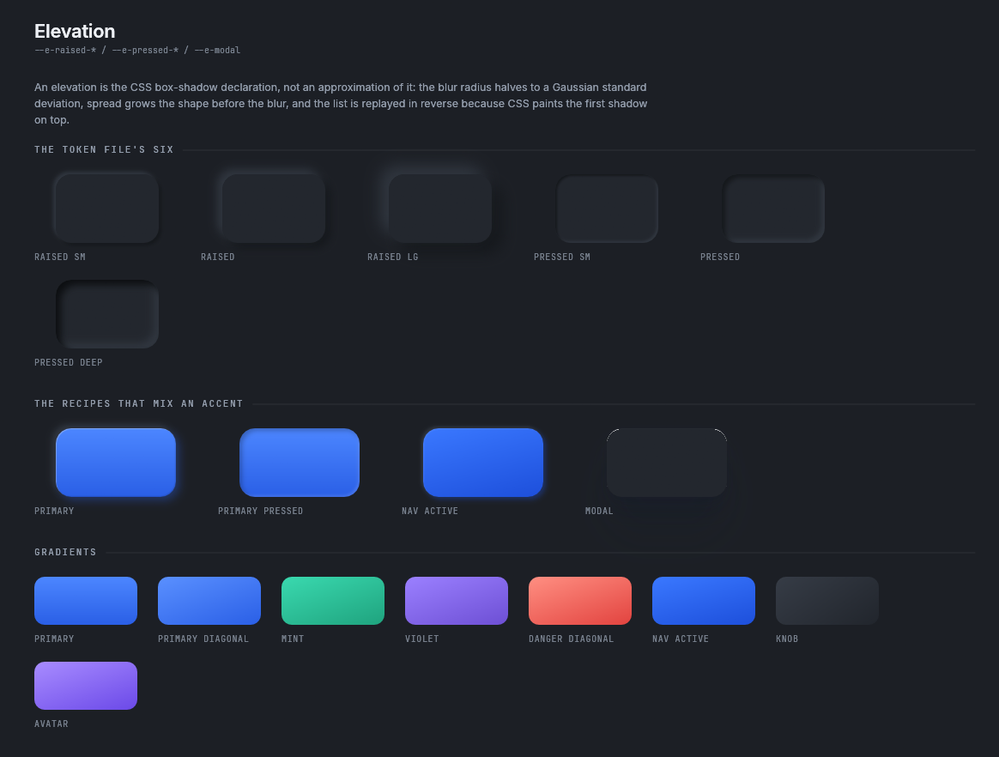
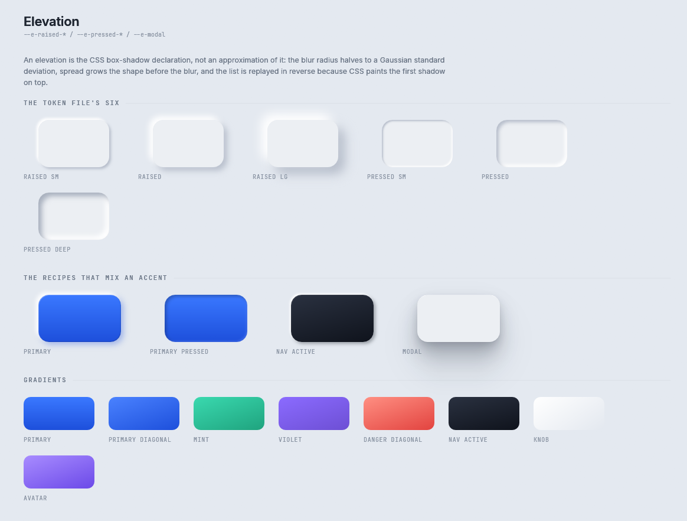
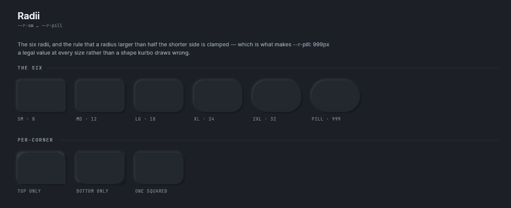
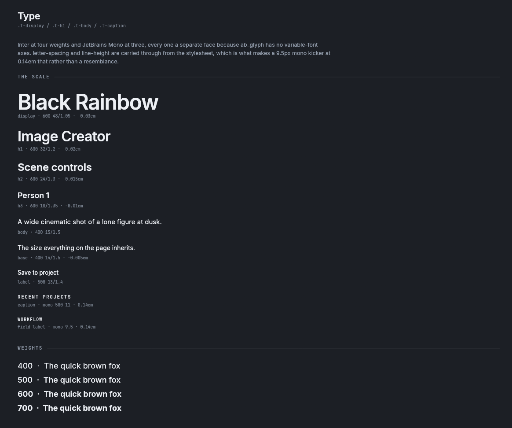

# Themes

A theme says what every colour, radius, shadow and gradient in rux is. A component reads the theme and
never names a colour of its own, so changing the theme changes every component at once. This page
lists the tokens a theme has, the two themes that ship, and how to make a theme from another
application's palette.

## Choosing a theme

```rust
use rux::prelude::*;

let state = RuxState::new(Theme::named("dark-neumorphic").unwrap());

// later, from a settings menu
state.set_theme(Theme::named("light-neumorphic").unwrap());
```

`Theme::named` answers `None` for a name that does not exist, and `Theme::names()` lists the names that
do. `Theme::all()` returns every theme in the order the storybook lists them. Switching theme
rasterises every layer again on the next frame, because every colour in every `Decor` list changed.
Nothing has to be cleared by hand.

| Name | Label | Copied from |
|---|---|---|
| `light-neumorphic` | Light Neumorphic | `reference/neumorphic-tokens.css`, which is ai-service's normal mode |
| `dark-neumorphic` | Dark Neumorphic | the same file with `reference/incognito-theme.css` applied over it, which is ai-service's incognito mode |

## A theme cannot add a name

`Theme` is a plain struct, and its list of fields is fixed. A theme gives each field a value. It cannot
add a field.

That rule comes from the reference. `incognito-theme.css` changes the whole ai-service interface from
light to dark by overriding values and changing no CSS rule at all. rux keeps the same property:
`the_dark_theme_changes_no_recipe_at_all` checks that both themes have elevations with the same number
of shadows, in the same order, and gradients at the same angles. So there is no branch on the theme
anywhere in `components/`. `Theme::dark` is read in one place, `Tile`, to choose the ink drawn over a
dropzone that is dark in both themes.

A token the design needs and `Theme` does not have is a change to `Theme`, to both themes and to
`tests/reference.rs`, in one commit.

## The tokens

### Colour



<details><summary>The same tokens in the light theme</summary>



</details>

| Field | Tokens | What they are for |
|---|---|---|
| `surface` | `s0`, `s1`, `s2`, `s3`, `sunken` | The page and the surfaces on it. `s1` is the page (`body { background: var(--surface-1) }`). `sunken` is the colour of a scrollbar thumb and a deep well. |
| `shadow` | `light`, `dark`, `darker` | The two tones every elevation is made from, and a deeper one for a pressed well. In the light theme they are `#FFFFFF` and `#B8BFCC`. Both are fully opaque. The softness comes from the blur. |
| `ink` | `i900`, `i700`, `i500`, `i400`, `i300`, `i200` | Text and marks, from strongest to faintest. |
| `accent` | `blue`, `blue_deep`, `blue_soft`, `coral`, `violet`, `mint`, `amber`, `rose` | Emphasis. `blue` is the action colour. |
| `semantic` | `success`, `warning`, `danger` | What a state means. |
| `interaction` | `hover`, `pressed`, `hairline`, `accent_wash`, `accent_wash_soft`, `scrim`, `focus_ring` | The flat colours `egui` draws over a surface: the hover and press washes, divider lines, the dimmed page behind a dialog, and the keyboard focus ring. |

### Elevation



<details><summary>The same elevations in the light theme</summary>



</details>

An elevation is a list of up to six shadows, each a CSS `box-shadow` entry with an offset, a blur, a
spread, a colour and whether it is inset. [How rux draws](architecture.md#an-elevation-is-a-css-box-shadow)
explains how one is drawn.

| Field | CSS custom property | Used by |
|---|---|---|
| `raised_sm`, `raised`, `raised_lg` | `--e-raised-sm`, `--e-raised`, `--e-raised-lg` | buttons, chips, cards, panels |
| `pressed_sm`, `pressed`, `pressed_deep` | `--e-pressed-sm`, `--e-pressed`, `--e-pressed-deep` | fields, wells, a held button, a chosen segment's track |
| `modal` | `--e-modal` | dialogs and menus |
| `primary`, `primary_pressed`, `primary_sm` | `--e-primary*` | the blue action button |
| `nav_active` | `--e-nav-active` | the chosen item in the top nav |
| `image_well` | `--e-image-well` | the dropzone a picture goes in |

`Theme::glowing(glow, lift)` makes the one recipe the reference writes four times with a different
accent each time: a raised surface whose lower shadow is a colour. The dice toggle when it is on, the
preset chip and the dialog's Save button use it.

### Radii



`radius.sm`, `md`, `lg`, `xl`, `xxl` and `pill`, from `--r-sm` to `--r-pill`.

### Gradients

`gradient` has twelve: `primary`, `primary_diagonal`, `danger`, `danger_diagonal`, `mint`, `violet`,
`nav_active`, `knob`, `avatar`, `image_well`, `progress` and `multistop`. Each is an angle and two
colours, copied from a `linear-gradient(...)` declaration. `Fill::gradient(gradient, rect)` paints one
across a rectangle.

### Type



The type scale is in `rux::text::Style`, not in the theme, because both themes use the same faces.

| Style | Face and size | CSS rule |
|---|---|---|
| `Style::DISPLAY` | Inter 600, 48, tracking −0.03em | `.t-display` |
| `Style::H1`, `H2`, `H3` | Inter 600 at 32, 24 and 18 | `.t-h1` to `.t-h3` |
| `Style::BODY`, `BASE` | Inter 400 at 15 and 14 | `.t-body` |
| `Style::LABEL` | Inter 500, 13 | |
| `Style::CAPTION` | JetBrains Mono 500, 11, uppercase, tracking 0.14em | `.t-caption` |
| `Style::FIELD_LABEL`, `CTRL_LABEL` | JetBrains Mono 9.5 and 9, uppercase, tracking 0.14em | the small labels over a field |
| `Style::PANEL_TITLE` | JetBrains Mono 500, 10.5, uppercase, tracking 0.16em | a panel's heading |
| `Style::CONTROL`, `CONTROL_LG`, `BUTTON` | Inter 500 at 12 and 13, Inter 600 at 14 | text inside controls |
| `Style::PROSE` | Inter 400, 13, line height 1.6 | running text |
| `Style::NUMBER` | JetBrains Mono 600, 12 | a value in a control |

A style is built with `const` methods, so a new one can be a constant:

```rust
const KICKER: Style = Style::mono(9.5).tracking(0.14).upper();
let galley = rux.text(KICKER, "Project", rux.theme().ink.i400);
```

## The Agent-Chat values

`theme.chat` holds the colours of the Agent-Chat, Agent-Tasks and Settings designs Unluminous uses:
the card gradient, the well, the action gradient and its glow, the chart colours, the colours for faster,
slower and waiting, and the chip surfaces the task board uses.

These values are worked out, not copied. `Chat::lit_from(ground, dark)` writes each colour from the
design canvas as a step from the canvas's own pane colour, `#1F232A`. On that pane the result is the
canvas's exact hex. On any other pane it is the same steps from that pane. So the chat parts follow
whichever theme they are drawn on. `theme.chat` holds colours only. The shadows are methods, so both
themes still share every recipe.

## A theme made from another application's palette

```rust
let base = Theme::named("dark-neumorphic").unwrap();
let mine = base.retoned("unluminous-dark", my_surfaces, my_shadows, my_ink, my_blue);
```

`Theme::retoned` keeps every recipe and replaces the surfaces, the shadow tones, the ink and the blue
accent. It works the elevations, the focus ring, the hover washes and `theme.chat` out again from the
new values. Unluminous uses it so that a rux control drawn beside its own panes is in its own colours.

`RuxState::new` and `set_theme` take a `&'static Theme`, so a retoned theme is kept somewhere that
lives for the whole program, such as a `std::sync::OnceLock` or `Box::leak`.

## Where to go next

- [Layout](layout.md): placing components.
- [Components](components/README.md): every component, and which tokens it reads.
