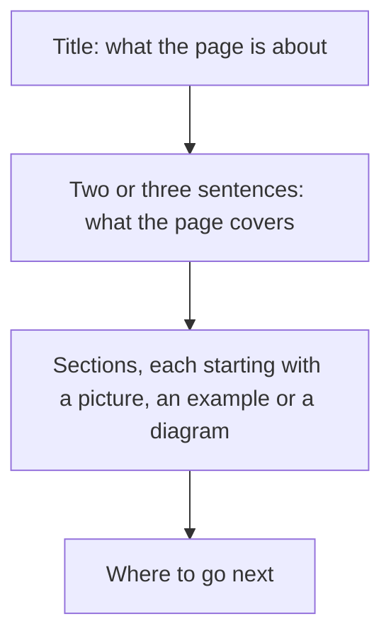

# How to write rux documentation

This page is the style guide for every page in `docs/`, for the readme, and for the comments in the
code. Read it before you write or change a page.

Most readers are Rust programmers who have used `egui` or a web component library, and who have never
looked inside a renderer. They know what a widget and a theme are. They may not know what an inset
shadow, a Gaussian blur or a texture atlas is. Write for that reader.

## The rules

1. **Short declarative sentences.** One idea per sentence. If a sentence has two clauses joined by a
   dash, a semicolon or "which", split it into two sentences.
2. **Plain words.** Use the common word: "write" for "materialise", "show" for "surface", "use" for
   "reach for".
3. **Name the thing every time.** Write "`Select` opens its menu on its own layer", and in the next
   sentence write `Select` again. Do not write "the component", "it" or "this" when the reader could
   lose track of what you mean.
4. **Say what is true and stop.** Do not add a contrast clause to make a sentence sound stronger.
5. **Explain a term the first time a page uses it**, or link it to [the glossary](glossary.md).
6. **Show, then explain.** Put a picture, a code block or a diagram near the top of a section, then
   describe what it shows.
7. **Every number has a source.** A number is printed by a program in this repository, measured and
   recorded in a design document under `tasks/`, or read out of a file under `reference/`. Say which.
8. **Present tense, about the code as it is.** The history of how it got there belongs in the commit
   log and in the design documents.
9. **British spelling in prose**, and the spelling the code uses where a name in the code is quoted,
   such as `color` in `egui` and `Color32`.

## What not to write

| Do not write | Why | Write instead |
|---|---|---|
| An em dash or an en dash | It joins two sentences that should be separate | Two sentences |
| Words joined by a hyphen, like "built-in" or "hover-state" | They read as invented terms | "built in", "the hover state" |
| "X, not Y" when Y is only there for contrast | It adds an idea the reader did not need | "X" |
| "worth noting", "to be clear", "put simply" | It announces a sentence instead of writing it | Delete the announcement |
| "the shape of", "surface" as a verb, "vocabulary" | A vague word where a concrete one exists | "the list of values" |
| "blows up", "kills" for a failure | Dramatic words for an error | "the process panics with ..." |
| An idiom, a metaphor or a saying | The reader has to translate it | The fact it stands for |

A hyphen is fine inside a name somebody else chose, such as `vello_cpu`, `box-shadow`,
`letter-spacing`, a CSS class like `.ic-select`, or the design canvas page names "Agent-Chat" and
"Agent-Tasks".

## How a page is laid out

- **Pictures.** A component page shows the storybook story for that component, in the dark theme, with
  the light theme in a fold under it. `pwsh tools/capture-docs.ps1` takes every picture in
  `docs/images/`. Never edit a picture by hand. Take it again.
- **Tables.** Use a table for anything the reader will look up: builder methods, variants, tokens,
  switches.
- **Code blocks.** Every snippet uses the API as it is in `crates/rux/src`. When a signature changes, the
  page that quotes it changes in the same commit.

## Keeping pages correct

A change that alters what a component looks like or how it is called updates, in the same commit:

- the component's page under `docs/components/`,
- its pictures, by running `pwsh tools/capture-docs.ps1 -Stories <the story>`,
- and the storybook story, so the picture shows the new state.
